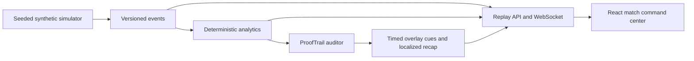

# PULSE XI

**Synthetic simulation · Football intelligence operating system**

An original local football match replay and analytics application. Three seeded fictional fixtures drive the match command center, deterministic statistics, ProofTrail goal evidence, synchronized cue JSON and preview, and limited rule-based English, Spanish and Hindi goal recaps. All clubs, players, match events and goals are fictional. No Premier League feed, footage or logos are used.

## Run locally

Prerequisites: Python 3.11+, Node 20+ and npm. On Windows, run `./scripts/start.ps1` in PowerShell. It installs dependencies if needed, builds the React frontend, and serves it with FastAPI at http://127.0.0.1:8000.

Manual backend:

```powershell
cd backend
python -m pip install -r requirements.txt
python -m uvicorn app.main:app --reload --port 8000
```

Manual Vite development frontend in a second terminal:

```powershell
cd frontend
npm install
npm run dev
```

API docs: http://localhost:8000/docs. Tests: `cd backend; python -m pytest tests -q -p no:cacheprovider` and `cd frontend; npm run build`.



The current milestone delivers a functioning local replay and initial evidence, broadcast and persona experiences. Tactical pattern insights, full FanDNA, Foundry agents, durable persistence, and Azure deployment are later phases; see [project status](docs/PROJECT_STATUS.md). The API `/health` reports the narrative provider as unconfigured: no LLM inference is claimed.
