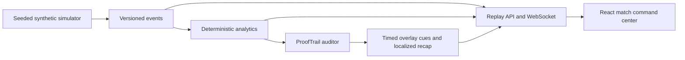

# PULSE XI

**Synthetic simulation · Football intelligence operating system**

An original local football match replay and analytics application. Three seeded fictional fixtures drive the match command center, deterministic statistics, verified goal and tactical insights, synchronized cue JSON and preview, and five replay-clock recap modes with limited rule-based English, Spanish and Hindi text. Imported synthetic matches persist in SQLite. All clubs, players, match events and goals are fictional. No Premier League feed, footage or logos are used.

## Run locally

Prerequisites: Python 3.11+, Node 20+ and npm. On Windows, run `./scripts/start.ps1` in PowerShell. It installs dependencies if needed, builds the React frontend, and serves it with FastAPI at http://127.0.0.1:8000.

Manual backend:

```powershell
cd backend
python -m pip install -r requirements.txt
python -m uvicorn app.main:app --reload --port 8000
```

Manual Vite development frontend in a second terminal:

```powershell
cd frontend
npm install
npm run dev
```

API docs: http://localhost:8000/docs. Tests: `cd backend; python -m pytest tests -q -p no:cacheprovider` and `cd frontend; npm run build`. Browser tests: `cd frontend; npx playwright install chromium; npm run test:e2e`.

The **Sandbox Lab** navigation opens a working fixture workspace at `/#/sandbox`: generate a fictional replay from a seed, select recorded events and inspect pass difficulty and evidence. This currently uses the existing precomputed fixture API. Live tactical interventions, engine checkpoints and ForkCast await the authoritative simulator contracts. See the [implementation and team handoff](docs/SATVIK_IMPLEMENTATION.md) and [pass formula](docs/PASS_DIFFICULTY.md).

The optional **3D Observer** adds an original Blender stadium, recorded event markers, five camera modes and Low/Medium/High graphics profiles. The default 2D view remains independent of WebGL. See the [graphics toolchain, reproducible assets and measured results](docs/PROFESSIONAL_3D_GRAPHICS_UPGRADE.md). Positions remain sparse synthetic event snapshots; no continuous player tracking is inferred.



The current milestone delivers a functioning local replay, event-derived tactical views, verified tactical changes, durable ingest, and five focused recap modes. Full interface localization, richer producer controls, authenticated Foundry invocation, and Azure deployment remain; see [project status](docs/PROJECT_STATUS.md). The API `/health` reports the narrative provider as unconfigured: no LLM inference is claimed.
