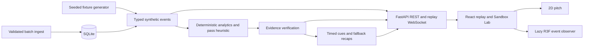

# PULSE XI

[](https://github.com/Microsoft-Game-Developer-Hackathon-2026/Pulse-Xi/actions/workflows/ci.yml)

**Synthetic football intelligence for fans, analysts and broadcast producers.**

A Microsoft Game Developer Hackathon 2026 project turning fictional football events into deterministic statistics, inspectable tactical explanations, synchronized broadcast cues and personalized recaps. Sandbox Lab currently explores reproducible, precomputed fixtures; it is not an authoritative interactive match engine. All teams, players and events are synthetic. No Premier League feed, club logos, real-player tracking or broadcast footage is used.

## Current main functionality

| Capability | Status and boundary |
|---|---|
| Synthetic fixtures | Three built-in seeded matches and validated custom seeds; reproducible on the same supported build |
| Replay | Play/pause, speed, seek, event stepping/filtering and selected-event pitch; refresh restores custom match identity and resets time |
| Analytics | Event-derived passes, shots, recoveries, pressure activity, networks, player summaries and windowed activity proxies |
| ProofTrail | Goal/tactical insights with supporting events and deterministic numerical verification |
| Pass Difficulty | Versioned 0–100 geometry heuristic with inspectable factors and player summaries; not a failure probability; pressure coverage unavailable |
| Sandbox Lab | Working fixture-generation and replay workspace; live engine controls remain blocked |
| 3D Observer | Lazy procedural pitch/stadium, five cameras, Low/Medium/High profiles, recorded-event evidence and 2D/WebGL fallback |
| Broadcast/FanDNA | Timed cue JSON/preview and five recap modes; limited English, Hindi and Spanish templates, not full interface translation |
| Persistence | SQLite imported-event persistence and idempotent ingest; built-in/custom fixtures regenerate |
| Microsoft AI | Guarded optional provider code; verified local path uses deterministic fallback, not authenticated model inference |

**Not merged:** PR #31's editable Blender/GLB kit awaits Vishwam's asset/security approval. PRs #32/#33 prepare checkpoint metadata and isolated comparison display; they remain behind #31. No checkpoint continuation, intervention engine, branch runner, calibrated prediction, public Azure deployment or real multi-agent inference is claimed. See the [current handoff](docs/SATVIK_INDEPENDENT_HANDOFF.md).

## Windows quick start

Prerequisites: Python 3.11+, Node **20.19+ or 22.12+** (Vite requirement), npm and PowerShell. Verification used Python 3.13 and Node 24. From the repository root:

```powershell
python -m venv .venv
.\.venv\Scripts\Activate.ps1
.\scripts\start.ps1
```

Startup installs backend requirements, runs `npm ci` when `node_modules` is absent, builds the frontend and starts FastAPI at **http://127.0.0.1:8000**. Sandbox: **http://127.0.0.1:8000/#/sandbox**. API docs: **http://127.0.0.1:8000/docs**. No credentials, Blender, Unreal or paid service is required. Stop with Ctrl+C. If port 8000 is occupied, use `.\scripts\start.ps1 -Port 8769` and open the corresponding URL; the default remains 8000.

After lockfile changes, run `npm ci` in `frontend` explicitly; startup does not reconcile an existing dependency directory. If activation is unavailable, use your configured interpreter directly rather than weakening system security policy.

### Manual development

```powershell
# Terminal 1, repository root
python -m pip install -r backend/requirements.txt
python -m uvicorn app.main:app --app-dir backend --host 127.0.0.1 --port 8000
```

```powershell
# Terminal 2, repository root
cd frontend
npm ci
npm run dev
```

Open the Vite URL printed by the command. Its API/WebSocket proxy targets port 8000. FastAPI serves `frontend/dist` after production build. Optional backend-only configuration is in [Foundry](docs/FOUNDRY.md); never put secrets in frontend variables. Keep hosted inference disabled without explicit authorization.

## Demonstration

1. Open Sandbox Lab and generate a replay with an integer seed from 0 to 2,147,483,647.
2. Play, pause, change speed and seek forward/backward; statistics follow the replay clock.
3. Filter recorded events and select a pass; inspect the path, difficulty factors and evidence.
4. Open ProofTrail to inspect supporting events; close with Escape.
5. Open 3D; choose Broadcast, Tactical, Isometric, Event focus or Free camera. Try quality profiles and reset.
6. Inspect source coordinates, return to 2D and continue replay.
7. Refresh: the saved custom fixture is recovered and replay starts at kickoff.

Replay controls view recorded events, not a running server simulation. Coordinates are normalized units, not measured metres. Markers represent sparse event locations; no continuous tracking, player speeds or ball trajectories are inferred.

## Architecture and stack

The optional **3D Observer** adds an original Blender stadium, recorded event markers, five camera modes and Low/Medium/High graphics profiles. The default 2D view remains independent of WebGL. See the [graphics toolchain, reproducible assets and measured results](docs/PROFESSIONAL_3D_GRAPHICS_UPGRADE.md). Positions remain sparse synthetic event snapshots; no continuous player tracking is inferred.



Frontend: React 19, strict TypeScript, Vite, Tailwind/CSS, Three.js and React Three Fiber. Backend: Python, FastAPI, Pydantic and SQLite. pytest/Playwright exercise APIs and browsers. Calculations stay outside language models. Future authoritative state/clock/RNG ownership belongs to Diyan, not the replay client.

```text
backend/app/                  models, generator, analytics, evidence, APIs, storage
backend/tests/                API, determinism, persistence and scoring tests
frontend/src/features/passes/  pass inspector and typed responses
frontend/src/features/sandbox/ fixture setup, timeline, replay transport
frontend/src/features/observer/ lazy procedural 3D, cameras, evidence overlay
frontend/tests/               browser and transport regressions
scripts/                      Windows build/start and scoring benchmark
docs/                         contracts, methodology and handoff
.github/workflows/            backend/frontend/browser CI
```

## Testing

```powershell
# Repository root
python -m pip install -r backend/requirements.txt
cd backend
python -m pytest tests -q -p no:cacheprovider
```

```powershell
# frontend directory
npm ci
npx playwright install chromium
npm run build
npm run test:e2e
```

`build` includes strict TypeScript. Playwright starts a real FastAPI server on port 8765; avoid an unrelated process using that port. CI uses software rendering for reproducibility, not physical GPU performance evidence. Final counts and measured limitations are in the handoff.

Asset validation (`python scripts/asset_contract.py`, `npm run validate:assets`) and `npm run test:contracts` belong to unmerged #31/#33 respectively; **they are not available on this main baseline**.

## Graphics pipeline and provenance

Main's observer is procedural and independently usable. Blender 5.2.2 authored an original editable source/GLB pipeline on PR #31, including manifest hashes, export tools and Khronos checks. Main also includes a renderer probe that supports procedural and asset-enabled scenes. It remains unmerged pending release review. Unreal #34 is optional offline authoring; neither tool is a browser runtime requirement. No mandatory CUDA, RTX, Pixel Streaming or cloud GPU is introduced.

The handoff records separate physical Iris Xe and software-renderer evidence; neither certifies RTX performance. Asset licenses and provenance are in PR #31's `assets/LICENSE.md` and `assets/manifest.json`, not yet main. No asset release approval is implied; third-party package licenses remain applicable.

### Repeat physical-GPU measurement

With the application running, use the frontend directory:

```powershell
$env:PULSE_GRAPHICS_HARDWARE='1'
$env:PULSE_GRAPHICS_URL='http://127.0.0.1:8000'
npm run measure:graphics
```

The headed browser rejects a detected software renderer, records renderer identity, active-orbit browser frame pacing and bounded interaction/heap observations in ignored `test-results/graphics/intel-hardware.json`. The filename is historical; inspect the renderer field to identify actual hardware. It does not certify GPU timer FPS or replace a longer physical-hardware test. Without hardware opt-in the probe uses headless Chromium. Keep the browser visible/unoccluded during measurement.

## Team and contributions

- Diyan: authoritative simulator, tactics, interventions, manifests; optional RTX work.
- Satvik: Sandbox consumers, checkpoints/ForkCast UI, pass difficulty and observer.
- Mahir: Microsoft AI, verified intelligence, personalization and broadcasts.
- Vishwam: release/security/provenance, deployment, broader QA and submission documentation.

Use focused branches/PRs with reproducible evidence. Do not push directly to main, force-push, overwrite teammates or close engine-dependent issues for preparation-only work. This is the current integration baseline; Vishwam retains final submission documentation/review ownership.

## Documentation

- [Current status](docs/PROJECT_STATUS.md)
- [Independent handoff and next integration sequence](docs/SATVIK_INDEPENDENT_HANDOFF.md)
- [API/event contract](docs/CONTRACT.md)
- [Pass methodology](docs/PASS_DIFFICULTY.md)
- [3D Observer](docs/3D_OBSERVER.md)
- [Optional Foundry path](docs/FOUNDRY.md)
- [Historical implementation audit](docs/SATVIK_IMPLEMENTATION.md)

## Troubleshooting

| Symptom | Action |
|---|---|
| Python import failure | Use the intended interpreter/venv; install `backend/requirements.txt` |
| Missing or stale Node modules | Run `npm ci` in `frontend`; check Node version |
| Port 8000 occupied | Stop its known owner or use another manual uvicorn port; do not terminate unknown processes |
| Startup exits | Fix the first dependency/build error; startup stops on failures |
| Blank/failed 3D | Return to 2D, try Low, check WebGL2/hardware acceleration; replay remains independent |
| Blender not found | Main does not require Blender; authors on #31 can set `PULSE_BLENDER_PATH` |
| Missing asset/contract command | Utilities remain on the unmerged branches, not this main baseline |

### Limitations

Synthetic streams are simplified and not calibrated against real football outcomes. Full localization, advanced studio editing, authenticated Microsoft inference, Azure hosting and authoritative experimentation remain incomplete. A seed alone is not a full experiment manifest. The handoff identifies owners and exact integration gates.
