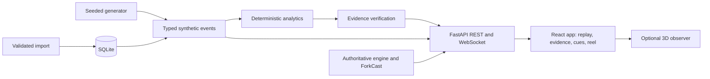

# PULSE XI

[](https://github.com/Microsoft-Game-Developer-Hackathon-2026/Pulse-Xi/actions/workflows/ci.yml)

**Synthetic football intelligence, with evidence behind every story.**

PULSE XI turns synthetic football events into explainable match intelligence: deterministic statistics, inspectable tactical explanations, synchronized broadcast cues, audience-specific recaps and reproducible tactical experiments. Every explanation links back to the events that support it. All teams, players and events are synthetic; no Premier League feed, club marks, tracking data or match footage is used.

Built for the Microsoft Game Developer Hackathon 2026 (Inside the Game).

## Try it

| | |
|---|---|
| **Live demo** | <https://pulse-xi-demo.onrender.com>: public, read-only, no login. It runs on a free plan: after 15 idle minutes the first request takes up to about a minute to wake up, and each panel loads noticeably slower than on a local run |
| **Source** | this repository (public) |
| **Run locally** | [Quick start](#quick-start) below. Only the local run includes the Control Room, imports and Director Studio approval, which the public demo disables by design |
| **Demo video** | under 2 minutes; the public link is entered in the hackathon submission. How it was produced and checked: [video production report](docs/VIDEO_PRODUCTION_REPORT.md) |

**A 60-second tour of the live demo:** choose speed 2× and press Play (the 16:40 goal arrives after about 17 seconds), watching the score change while the page stays still; in *Broadcast studio / Verified cues* click the first cue, then **Inspect evidence**; read the three framings of that one moment (analyst, fan, broadcast director) and the check that they cite the same source events; switch **VIEW** and **LANGUAGE** under *FanDNA / Recap* and watch the wording change while the facts stay fixed; open **Open event-derived highlight reel** at the bottom of the page.

## The five-stage challenge, and where it lives

| Stage | What PULSE XI does | Where |
|---|---|---|
| Ingest | Seeded synthetic match generator, validated and checksummed package import, recorded replay over REST and WebSocket | `backend/app/simulator.py`, `data_hub.py`, Match Data Hub |
| Interpret | Event-derived metrics, tactical windows, Control vs Chaos, a heuristic Pass Difficulty (0-100, not a probability) | `backend/app/analytics.py`, `pass_difficulty.py` |
| Explain | Verified rule-based insights with exact source events (ProofTrail); **One Moment · Three Stories** frames one moment as analyst, fan and director from the same events, with a computed same-source check | `backend/app/evidence.py`, `frontend/src/ThreeStories.tsx` |
| Render | Timed lower-third cue JSON and Director Studio approval, an event-derived highlight reel (player and WebM renderer), 2D pitch and an optional 3D observer | `frontend/src/DirectorStudio.tsx`, `HighlightReel.tsx`, `features/observer` |
| Personalize | Five audience modes and English, Spanish and Hindi for the fan flow (English fallback is shown honestly), Fan Lens alerts, opt-in on-device speech. Wording changes; facts never do | `frontend/src/fandna.ts`, `backend/app/fan_lens.py` |

Beyond the pipeline, an authoritative **Control Room** runs a deterministic engine on the server (seeded clock and RNG): configure a scenario, step or run it, apply tactical interventions, save exact checkpoints, restore them as new branches, run paired **ForkCast** experiments against a baseline, and verify the result with an independent process. See the [Live Sandbox guide](docs/LIVE_SANDBOX.md).

## Architecture



Frontend: React 19, strict TypeScript, Vite, Three.js. Backend: Python 3.13, FastAPI, Pydantic, SQLite. Calculations never go through a language model; the browser never advances authoritative state. Deployment: one container serving the built frontend and API ([Dockerfile](Dockerfile), [render.yaml](render.yaml)). Detail: [AUTHORITATIVE_ENGINE](docs/AUTHORITATIVE_ENGINE.md), [CONTRACT](docs/CONTRACT.md), [reference guide](docs/REFERENCE_GUIDE.md).

## Microsoft technologies: what actually runs

| Technology | Status |
|---|---|
| Microsoft Agent Framework and Foundry adapter (`agent-framework-foundry`, `agent-framework-orchestrations`) | **Optional and verified offline only.** A staged Analyst → Story Editor → Evidence Auditor → Director → Fan workflow with per-role tool allowlists, a deterministic auditor and observed-stage traces is implemented and tested with fakes. **No authenticated hosted model call has been made**, and nothing in the app presents rule-based text as model output |
| Azure Container Apps (Bicep template, GitHub Actions) | Prepared and compiled in CI; **nothing is provisioned** |
| GitHub Actions | Six CI jobs: backend, frontend, browser, container, documentation, deployment-template |

Details and the live-validation procedure: [FOUNDRY](docs/FOUNDRY.md), [AGENT_ORCHESTRATION](docs/AGENT_ORCHESTRATION.md).

## Quick start

Tested with Python 3.13 and Node 24 (Vite needs Node 20.19+ or 22.12+).

```powershell
# Windows, from the repository root
python -m venv .venv
$env:Path = "$(Resolve-Path .venv\Scripts);$env:Path"
.\scripts\start.ps1          # installs, builds, serves http://127.0.0.1:8000
```

```bash
# macOS / Linux
python3 -m venv .venv && source .venv/bin/activate
python -m pip install -r backend/requirements.txt
(cd frontend && npm ci && npm run build)
python -m uvicorn app.main:app --loop app.local_event_loop:create_loop --app-dir backend --host 127.0.0.1 --port 8000
```

Open `http://127.0.0.1:8000`. Read-only analysis needs no credentials, Blender or paid service. The Control Room (`/#/runtime`) needs an operator token you generate yourself and keep in the server shell, for example `$env:PULSE_RUNTIME_TOKEN = python -c "import secrets; print(secrets.token_urlsafe(32))"`. Configuration, imports, backups and troubleshooting: [reference guide](docs/REFERENCE_GUIDE.md).

## Tests and quality

| Check | Result on the final code |
|---|---|
| Backend (`cd backend; python -m pytest tests -q`) | 549 tests |
| Browser (`cd frontend; npm ci; npx playwright install chromium; npm run build; npm run test:e2e`) | 146 tests: route health, replay stability, keyboard and focus behavior, axe-core WCAG A/AA scans (desktop, mobile, Spanish, Hindi, evidence drawer), Control Room, Data Hub, highlights |
| Public-demo acceptance (`PULSE_DEMO_URL=https://… npx playwright test -c playwright.deployed.config.ts`) | 4 tests against the live URL, including 35 s of playback without hitting the shared quota |
| Real-HTTP release smoke (`python scripts/release-smoke.py`) | scenario, checkpoint, ForkCast and two independent verifier processes on disposable databases |
| Dependency audits | `npm audit` and `pip-audit`: no known vulnerabilities |

CI runs the backend, browser and container checks on every push to `main`. Measurements and their limits: [performance audit](docs/PERFORMANCE_AUDIT.md).

## What it does not claim

- No real football data, tracking, speeds or calibrated prediction; Pass Difficulty and activity indexes are explained heuristics.
- No hosted AI: the narratives are rule-based templates, and the agent path is verified offline.
- No screen-reader test has been run; accessibility is covered by automated axe scans and keyboard tests.
- The public demo is a free-tier, read-only deployment without an uptime guarantee; capacity on that host is unmeasured.
- Operator pages are English-only.

## Licence and rights

No root open-source licence is declared, so the code is **all rights reserved** by default. The original procedural artwork carries a CC0 1.0 dedication ([assets/LICENSE.md](assets/LICENSE.md)); the Blender generator scripts are GPL-3.0-or-later; shipped dependencies are permissive. The owner waived an independent release review in favor of a documented checklist, so `assets/manifest.json` still reads `pending-team-review`. Evidence, reasoning and open choices: [LICENSE_AND_RIGHTS_DECISIONS](docs/LICENSE_AND_RIGHTS_DECISIONS.md).

## Team

- **Diyan**: authoritative simulator, tactics, interventions, manifests, deployment template; demo video.
- **Satvik**: replay and Sandbox consumers, checkpoints and ForkCast UI, pass difficulty, observer, evidence UI, release integration.
- **Mahir**: Microsoft AI adapter, verified intelligence, personalization and broadcasts.
- **Vishwam**: security, licensing and release review.

## Documentation map

| Start here | Then |
|---|---|
| [Submission packet](docs/HACKATHON_SUBMISSION_PACKAGE.md): pitch, description, technology list, reviewer guide | [Reference guide](docs/REFERENCE_GUIDE.md): configuration, Data Hub, backups, troubleshooting |
| [Readiness report](docs/FINAL_HACKATHON_READINESS_REPORT.md) and [judging matrix](docs/JUDGING_READINESS_MATRIX.md) | [Requirements traceability](docs/REQUIREMENTS_TRACEABILITY.md) and [requirements audit](docs/FINAL_REQUIREMENTS_AUDIT.md) |
| [Judge-access deployment](docs/JUDGE_ACCESS_DEPLOYMENT.md) | [Azure runbook](docs/AZURE_DEMO_DEPLOYMENT.md) (prepared, not provisioned) |
| [Video production report](docs/VIDEO_PRODUCTION_REPORT.md) and [storyboard](docs/VIDEO_NARRATION_AND_STORYBOARD.md) | [Highlight reels](docs/HIGHLIGHTS.md), [Pass Difficulty](docs/PASS_DIFFICULTY.md), [3D observer](docs/3D_OBSERVER.md), [UI design system](docs/UI_DESIGN_SYSTEM.md) |
| [Security threat model](docs/SECURITY_THREAT_MODEL.md) and [local security boundary](docs/LOCAL_SECURITY_BOUNDARY.md) | [Release readiness](docs/RELEASE_READINESS.md), [release evidence ledger](docs/RELEASE_EVIDENCE_LEDGER.md), [project status](docs/PROJECT_STATUS.md) |

Dated sections inside the audit and evidence documents are historical snapshots; the readiness report holds the final state.
