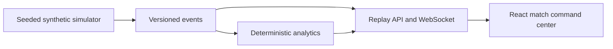

# PULSE XI

**Synthetic simulation · Football intelligence operating system**

An original local football match replay and analytics application. All clubs, players, match events and goals are fictional. No Premier League feed, footage or logos are used.

## Run locally

Prerequisites: Python 3.11+, Node 20+ and npm. On Windows, run `./scripts/start.ps1` in PowerShell. It installs dependencies if needed, builds the React frontend, and serves it with FastAPI at http://127.0.0.1:8000.

Manual backend:

```powershell
cd backend
python -m pip install -r requirements.txt
python -m uvicorn app.main:app --reload --port 8000
```

Manual Vite development frontend in a second terminal:

```powershell
cd frontend
npm install
npm run dev
```

API docs: http://localhost:8000/docs. Tests: `cd backend; python -m pytest -q` and `cd frontend; npm run build`. The Windows launcher uses a direct local bundle path because the coding sandbox blocks child processes spawned by Vite.



The current milestone delivers a functioning local replay. Evidence narratives, synchronized graphics, FanDNA, Foundry agents, persistence, and Azure deployment are later phases; see [project status](docs/PROJECT_STATUS.md).
