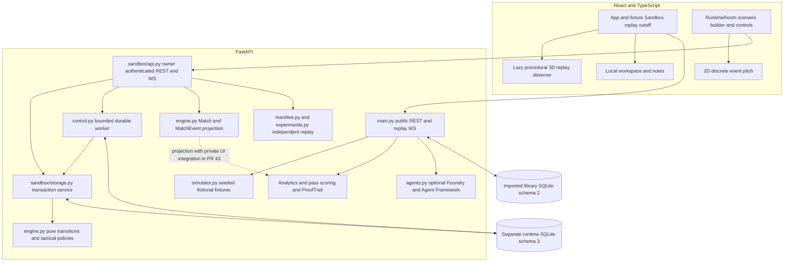
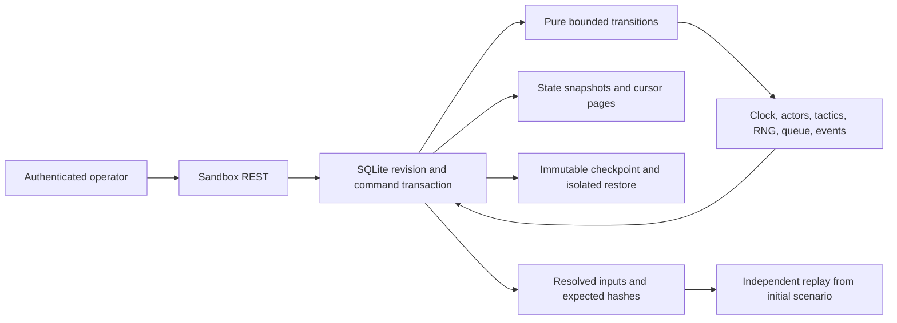

# Football Sandbox Lab architecture and authoritative engine

## Checkpoint-to-experiment acceptance update (2026-10-21)

This update starts from main `5a2613cbbc7a6514f39eddca02b1bc1acb3cf043`
(PR #61), whose exact-head CI passed. It incorporates #59's existing consumer work
with its authorship preserved and adds checkpoint UTC metadata, explicit reset/audit
states, and portable reproduction envelopes. The contracts below describe this
source tree; PR/merge and exact-head CI records determine integration status.

- `checkpoint_metadata.StoredCheckpoint` adds nullable original `created_at_utc`
  outside Snapshot/EngineState. Runtime schema 4 adds checkpoint_metadata; old rows
  stay null. Checkpoint, receipt, events, audit, state and metadata commit atomically.
  HTTP checkpoint command retries enrich the original receipt from that immutable
  metadata record. They never sample the current clock again.
- Checkpoint summaries also expose saved lifecycle. Only paused sources with future
  time are eligible for ForkCast. Completed/cancelled sources remain inspectable;
  restoring a terminal source does not invent more play.
- Reset creates a new session from the saved scenario. Restore forks immutable
  checkpoint history; in-place undo/redo and substitutions are not implemented.
  Audit acceptance stays append-only; applied status comes from the current
  engine intervention record, not the acceptance acknowledgment.
- `reproduction.py` wraps unchanged manifests with versioned, unsigned export-build
  context. Git revision/dirty state are nullable when unavailable; original execution
  host/revision were not recorded and are not inferred. Existing manifest endpoints,
  core serializers, RNG, version constants, implementation hashes and sample
  artifacts remain unchanged. API/CLI verification accepts old files and wrappers.

See [the complete wire/migration/verification contracts](LIVE_SANDBOX.md#checkpoint-metadata-and-reproduction-contracts).

## Historical integrated baseline (#64/#65)

Main `e88d6da40e8c02a407e57472574a44011f40b968` integrated #64's saved-scenario
library/archive contracts and runtime schema 3 metadata, following #53's runtime,
architecture, analysis and command hardening. Post-merge CI passed 248 backend and
55 browser cases; the handoff adds a mobile/keyboard test without changing runtime code. Core engine/schema/RNG versions and golden hashes
are unchanged. See [LIVE_SANDBOX](LIVE_SANDBOX.md#saved-scenario-library-and-archives)
for the current scenario API, provenance and migration rules. Self-review and
exact-head CI are recorded on the completion PR; no other person's approval,
cloud deployment or paid inference is claimed.

The branch availability table and dated verification counts in the next section
are historical audit evidence, superseded by this integrated baseline. Original
component, lifecycle and sequence contracts below still apply; scenario metadata
is outside the engine state/clock/manifest boundary.

## Issue #2 review scope (2026-10-21)

This is the shared architecture specification, extended rather than duplicated.
[LIVE_SANDBOX](LIVE_SANDBOX.md) supplies operational examples, [CONTRACT](CONTRACT.md)
the legacy wire contract, and [DECISIONS](DECISIONS.md) the architectural decisions.
The blueprint/master prompt express product intentions, not implemented schemas.

| Boundary | Observed head | Availability |
|---|---|---|
| main | `c79cf33` | Legacy fixtures/replay, analytics, procedural observer and library schema-2 lifecycle |
| PR #40 -> main | `9f340fa` | Implemented on an open feature branch: pure engine, runtime schema 1, checkpoints/manifests |
| PR #41 -> engine branch | `3e5cb79` | Implemented on an open feature branch: runtime schema 2, Control Room, jobs, observer, ForkCast |
| PR #43 -> live integration branch | `bc38aae` | Implemented on an open feature branch: private runtime analysis/export/3D adapters; included after normal merge of the architecture baseline; not on main |

Live browser inspection found #40/#41 open with six successful checks each;
Issues #2-#10 remain open. PR descriptions report respectively 148/171 backend
and 33/39 browser cases. #43 reports 178/42; its visible adapter diff was inspected,
but those results were not independently executed here. These historical counts
do not verify this revision or establish teammate approval. #31/#32/#33 remain
separate asset/preparation work; #42 is separate analytics work.

This revision is isolated on `feat/issue-2-architecture-alignment` from `3e5cb79`:
the schema-2 architecture requires both #40 and #41. Publication uses a dedicated
architecture PR with base `feat/live-sandbox-integration`, keeping its six-file
diff visible without changing #41 or teammate branches. Merge dependencies remain
#40 then #41, followed by architecture integration and the separately reviewed
#43. Terminal fetch/authentication now work; remote heads were refreshed and
confirmed unchanged. Nothing below is claimed merged or approved.

## Component ownership and trust boundaries

Solid components exist in this checkout (#40 + #41 + #43); main contains the legacy
side. Optional provider code exists, but authenticated hosted inference remains
unverified. No event broker, tracking service or account service is implemented.



`models.py` owns wire validation; `engine.py` owns football invariants, policies,
clock, capture and restore; `storage.py` owns owner scope, locking, receipts and
durability; `control.py` owns scheduling/CAS job progress; `experiments.py` owns
paired plans/comparisons and bundle verification. API handlers own transport/auth.
The browser owns viewing preferences, evidence selection and pending-operation UI.

## Lifecycle and main sequence

```mermaid
stateDiagram-v2
  [*] --> Paused: create session from resolved scenario
  Paused --> Paused: step below fulltime
  Paused --> Running: resume command
  Running --> Running: advance below fulltime
  Running --> Paused: pause command
  Paused --> Completed: step reaches duration
  Running --> Completed: advance reaches duration
  Paused --> Cancelled: cancel command
  Running --> Cancelled: cancel command
  Paused --> Paused: intervene queues tick+1; checkpoint increments revision
  Running --> Running: intervene queues tick+1; checkpoint increments revision
  Completed --> Completed: checkpoint only
  Cancelled --> Cancelled: checkpoint only
  note right of Paused
    Restore creates a new runtime with saved lifecycle.
    It never rewinds the parent. A terminal restore stays
    terminal. Historical inspection never mutates state.
  end note
```



```mermaid
sequenceDiagram
  actor Operator
  participant UI as RuntimeRoom
  participant API as Authenticated Sandbox API
  participant DB as Runtime transaction service
  participant Core as Pure engine
  participant Worker as Durable driver
  Operator->>UI: configure fictional scenario and connect
  UI->>API: POST scenarios (ScenarioConfig, bearer)
  API->>DB: save owner-scoped content-addressed scenario
  DB-->>UI: Scenario with resolved defaults and hash
  UI->>API: POST sessions (CreateSession)
  API->>DB: create owned session
  DB->>Core: initial_state
  DB->>DB: commit state, initial events and original receipt
  DB-->>UI: MutationResult (tick 0, revision 0, cursor 1)
  UI->>API: WS observe, bounded token first frame
  API->>DB: authenticate owner and read committed state
  API-->>UI: snapshot with complete events
  UI->>API: POST runs (RunRequest, current revision)
  API->>DB: commit durable job
  loop bounded worker passes
    Worker->>DB: stable command ID plus revision
    DB->>Core: copy-on-write resume or advance
    DB->>DB: atomic state, events, receipt and audit
    DB-->>Worker: original receipt on retry
    Worker->>DB: CAS job progress in separate commit
    API-->>UI: delta on committed revision change
  end
  UI->>API: cancel run then checkpoint command
  API->>DB: stop job, pause, store immutable checkpoint
  UI->>API: restore checkpoint with new operation ID
  API->>DB: new runtime with full state, prefix and ancestry
  DB-->>UI: child receipt; parent unchanged
  UI->>API: POST experiments from paused checkpoint
  Worker->>DB: restore paired children and execute recorded plans
  UI->>API: GET comparison and manifest
  API->>Core: independently replay and recompute comparison
  API-->>UI: verified descriptive results or explicit failure
```

Run cancellation, pause and job progress are separate transactions. An executing
bounded command may finish before acknowledgment. Revision/terminal checks and
job CAS prevent silently adopting another history. Manual pause makes an active
run stop on a stale revision; the UI cancels a known active run. Resume alone
never schedules work. Scenario creation and session creation are separate requests;
an interrupted pair can leave an unused scenario. No global transaction is promised.

## Authoritative model and version map

These are mappings to code, not extra payloads to implement. Sandbox `Model`
forbids extras and uses strict types/assignment validation. Pydantic scalar
constraints require additional `validate_state`, restore hashes, owner checks
and independent replay. Structural validity alone does not prove authenticity.

| Requested concept | Code authority/version | Validation and relationships |
|---|---|---|
| ScenarioConfig | `sandbox.models.ScenarioConfig`, sandbox/1, zone-engine/1 | Seed 0..2147483647; even duration 60..5400; neutral-dry; distinct teams and 22 unique player IDs; 11 players/team; attributes/tactics 0..100; defaults resolved and hashed in Scenario |
| Scenario archive | `scenario_archive.ScenarioArchive`, scenario-archive/1 | Existing Scenario + explicit engine-owned RNG provenance + UTC/null; outside EngineState; import rebuilds ID/hash; owner metadata stored separately |
| WorldState | `EngineState`, sandbox/1; no separate class | Full scenario, clock, score, possession/ball, 22 actors, tactics/policy revision, RNG, queue/decision counters, events/interventions; validate_state on load/transition/restore |
| Actor/tactical state | `ActorState`, `Tactics`, `PendingAction` within EngineState | GK/DF/MF/FW roles follow formation; stamina 0..10000, last action <= tick; no continuous actor positions, substitutions or physics |
| ClockState | EngineState tick/period/lifecycle + config duration; no separate class | Integer seconds, separate from UTC and browser elapsed time; period 2 starts at duration/2 after halftime event |
| Intervention | `Intervention` produced by `Command(kind="intervene")` | Current revision/tick, owned valid team/tactic, effective tick+1; old/new value, accepted -> applied. Runtime identity is in audit/envelope, not Intervention fields |
| Checkpoint | `Snapshot` + boundary `StoredCheckpoint` (extends CheckpointView), sandbox/1 | Full EngineState and digest, stored replay records/ancestry; revision after checkpoint command; nullable sidecar creation UTC; API restores owned stored IDs only |
| Branch | sessions row + manifest `Ancestor[]`; no Branch class | New runtime ID, copied state/events/operation prefix, independent future writes, preserved owner, ancestry depth 32; inherited operation IDs reserved |
| ExperimentManifest | `ExperimentManifest`, sandbox/1 | Resolved scenario, RNG/engine/schema versions, implementation hash, replay commands and expected hashes, ancestry/interventions/events; unsigned reproducibility evidence |
| Paired experiment | `control.ExperimentRequest/Experiment`; `ExperimentBundle` forkcast-manifest/1; `Comparison` forkcast/1 | 1..5 pairs, 1..600-second horizon, <=6 distinct tactical changes/arm, immutable parent and exact child end revisions |
| ObserverFrame | JSON envelopes in `api.observe`; no Pydantic class or standalone wire version | snapshot contains RuntimeView; delta omits state.events and adds from_cursor/events; WebSocket is not covered by OpenAPI |
| Match | `app.models.Match`, 1.0 | Synthetic true, synthetic-generator source, roster/metadata; base ID/reference constraints weaker than MatchPackage; package/ingest add validation |
| MatchEvent | `app.models.MatchEvent`, 1.0 | JSON type aliases event_type; sequence >=1, second 0..5400, fixed half boundary 2700; optional actors/coordinates; contextual roster checks outside base model |

Wire, engine, RNG and DB versions are independent. Literal-version models and
future DB versions fail closed. Core implementation digest binds normalized
models/engine/manifest source; experiment digest adds control/experiments. A source
change can invalidate old manifests: preserve matching builds with backups.
No general manifest converter/down-migration exists. Frontend types are manually
maintained subsets; they are not authoritative validators.

Adapter IDs are `session_id + "-" + sequence`; match_id=session_id,
match_second=tick; sequence/period preserved; possession IDs become strings.
Away x is mirrored into the legacy attacking frame, y unchanged. Synthetic
source/version defaults remain; UTC is deterministic 2000-01-01 + tick, not
ingestion time. Qualifiers identify engine/scenario/session/policy revision.
Only duration 5400 fits v1: others return 422 v1_requires_90_minutes; never
rescale short scenarios. Core event bytes omit runtime ID; evidence identity is
`(session_id, sequence)`. Projection never publishes private runtime events into
the public match library. Existing imports/replay remain on their original paths.
PR #43 reuses scoring/metrics/evidence/exports behind authenticated adapters;
its inspected diff rejects future cutoffs and scopes hashes to the captured
committed boundary, not a rewound cutoff. This integration is not fully tested
by this audit. Private runtime analysis/3D must not fall back to public APIs.

## State, clock and observer decisions

Committed SQLite EngineState is the live source of truth; pure engine transitions
alone advance one-second ticks. Revision counts accepted commands (even pause,
resume/checkpoint); policy_revision counts applied tactics. Sequence is contiguous
emission order from kickoff=1; event_cursor is its frontier. A page next_cursor
can trail the frontier. Library revision and imported sequences are independent;
imports can retain gaps. Tick cannot be inferred from event count or revision.

App playback changes a cutoff over precomputed fixture/imported events. RuntimeRoom
also filters committed events; `/history` reconstructs read-only state at a cutoff
<= current tick, possibly splitting a recorded step. Its reconstructed hash/revision
need not represent a previously committed receipt. Restore forks; neither seek nor
render timers rewinds or advances live state.

Observer accepts absent Origin or same-server/two hardcoded local Vite origins,
but always requires authentication. Send exactly `{"token":"<operator token>"}`
within five seconds and <=4096 characters after acceptance. Credentials are
rechecked every observation (250ms receive timeout); revocation/owner change
closes access. Only `ping` is accepted subsequently; no pong contract exists.
Initial snapshot is complete even with an older reconnect cursor. Revision-change
deltas start after the last sent cursor, including empty-event deltas. Cursor
ahead closes 4409, unauthorized closes 4403, forbidden Origin closes 1008.
No durable observer acknowledgment/backpressure protocol exists.

Frame shapes below are definitions, not standalone JSON payload examples:

```text
snapshot = {"kind":"snapshot", "view": RuntimeView.model_dump(mode="json")}
delta = {"kind":"delta", "view": RuntimeView with state.events omitted,
         "from_cursor": previous event_cursor, "events": EngineEvent[]}
```

Existing `examples/sandbox/journey.json` has executed REST payloads. RuntimeRoom
replaces state on snapshot, ignores older revisions and appends only if its local
cursor equals from_cursor. Gaps/errors switch to full authenticated state polling
every 1200ms. No automatic WebSocket reconnect loop exists; new connections always
snapshot. Refresh requires reauthentication; only runtime ID is in sessionStorage.
Poll/render timers never advance football.

## Full API index and status

All paths below start `/api/sandbox`, require bearer operator auth and conceal
foreign resources as 404. Success is **200**, including creation. Every row is
**Implemented on an open feature branch**. The behavioral contracts in the test
matrix are **Verified by tests** in this audit: 171 backend cases and 39 browser
cases passed. Generated schemas, success declarations and operator dependencies
were inspected for all 30 Sandbox HTTP operations; this is not exhaustive testing
of every input/error permutation. Historical CI above is separate; these are not main endpoints.
Existing main `/api/matches` and replay WS remain stable and public.

| Branch | Method/path | Request/query -> response | Consumer, concurrency and errors |
|---|---|---|---|
| #40 | GET /versions; /presets | none -> VersionInfo; map of ScenarioConfig | Setup, limits/build inspection |
| #40 | POST /scenarios; GET /scenarios/{id} | ScenarioConfig -> Scenario; none -> Scenario | Existing raw-config create/read; content-addressed, owner scoped; unchanged response |
| #3 completion | GET /scenarios | none -> ScenarioSummary[] | Owned stable ID order, <=100; no-store |
| #3 completion | POST /scenarios/import; GET /scenarios/{id}/archive | ScenarioArchive or ScenarioConfig -> ScenarioArchive; none -> ScenarioArchive | Recomputed identity, first stored metadata retained, 409 conflict; located 422/400/413 boundaries; no-store |
| #40 | POST /sessions | CreateSession -> MutationResult | Owner+operation identity; identical retry returns original creation boundary |
| #41 | GET /sessions | none -> SessionSummary[] | Owner's runtime/branch selector |
| #40 | GET /sessions/{id}/state; /snapshot | none -> RuntimeView; Snapshot | Current committed state/resync |
| #41 | GET /sessions/{id}/history | at_tick -> HistoricalView | Read-only seek, future=409 tick_ahead |
| #40 | POST /sessions/{id}/commands | Command -> MutationResult | step/advance/pause/resume/intervene/cancel/checkpoint/trial; expected_revision, intervention also requested_tick |
| #40 | GET /sessions/{id}/events | cursor 0..20000, limit 1..1000 -> EventPage | Exclusive cursor, ahead=409 cursor_ahead, consistent read snapshot |
| #40 | GET /sessions/{id}/match-events; /match | cursor/limit; none -> MatchEvent[]; Match | v1 adapter, 5400 only; events has no EventPage envelope |
| #40 | GET /sessions/{id}/audit | none -> AuditEntry[] | Valid accepted/rejected commands; UTC timestamp separate from clock |
| #40 | GET /checkpoints/{id} | none -> CheckpointView | Immutable owned checkpoint |
| #41 | GET /sessions/{id}/checkpoints | none -> CheckpointSummary[] | Picker |
| #40 | POST /checkpoints/{id}/restore | RestoreRequest -> MutationResult | New child; expected_revision belongs to checkpoint |
| #40 | GET /sessions/{id}/manifest; POST /verify | none -> ExperimentManifest; ExperimentManifest -> Verification | Download/replay; verified=false remains 200 |
| #41 | POST/GET /sessions/{id}/runs | RunRequest -> Run; none -> Run[] | Current revision, durable target/rate; repeated creation reconciles current job progress |
| #41 | GET /runs/{id}; POST /runs/{id}/cancel | no body -> Run | Recover/cancel job and pause runtime |
| #41 | POST/GET /experiments | ExperimentRequest -> Experiment; none -> Experiment[] | Owned paused checkpoint revision, bounded horizons/trials/changes |
| #41 | GET /experiments/{id}; POST /experiments/{id}/cancel | no body -> Experiment | Status/cancel children; completed evidence retained |
| #41 | GET /experiments/{id}/comparison; /manifest | none -> Comparison; ExperimentBundle | Replayed verification and exact terminal child cutoffs |
| #41 | POST /experiments/verify | ExperimentBundle -> Verification | HTTP body cap 2MB; independent CLI permits 20MB |
| #41 | WS /sessions/{id}/observe | cursor + token first frame -> snapshot/delta | RuntimeRoom; close codes/handshake above; absent from OpenAPI |

There is no separate branch-create, pause, intervention or checkpoint-create
route: use restore/command kinds. PR #43 additionally registers authenticated
session-relative `/analysis`, `/pass-difficulty`, `/passes/{event_id}/difficulty`,
`/passes/{event_id}/difficulty/evidence`, `/analysis-export`; absent from this
checkout's OpenAPI. See its actual adapter diff before integrating.

Runtime detail.code errors: 403 unauthorized; 404 not_found; 409 stale revision,
tick, lifecycle, duplicate intent or cursor conflict; 422 invalid boundary/corrupt
snapshot; 429 finite capacities; 503 missing auth/database/write failure. Framework
422 uses located arrays. RequestBoundary independently returns string detail for
400 ambiguous/nonfinite/deep JSON or 413 bodies >2MB. Shared ErrorResponse
declarations do not model all these families. Actual TestClient GET `/openapi.json`
returned OpenAPI 3.1.0 with 73 component schemas and 30 Sandbox HTTP operations.
All 30 declare 200 and the Authorization header and use require_operator. Some
schemas have distinct `-Input`/`-Output` names (for example ScenarioConfig and
EngineState); consumers must follow actual references, not assume unsuffixed names.
MatchEvent retains the JSON `type` alias; ScenarioConfig input forbids extra fields.
The header appears optional in OpenAPI because the dependency supplies a default,
but authorization is mandatory at runtime; denial behavior is tested. Generate
clients from this actual schema and preserve the documented error-family caveat.

## Persistence, migration and restart boundaries

| Store | Responsibility | Recovery |
|---|---|---|
| Library PULSE_DB_PATH, schema 2 | matches/events/package_metadata/match_lifecycle/deleted_matches; public reads, shared import capability | Separate atomic 0->1 and 1->2 migrations; scripts/database-admin.py; restored admin generations rotate |
| Runtime PULSE_RUNTIME_DB_PATH, schema 4 | scenarios/scenario_metadata/sessions/commands/runtime_events/checkpoints/checkpoint_metadata/audit/runs/experiments; owner scope | Atomic 0->1->2->3->4 steps; metadata migrations preserve deterministic payloads; app.sandbox.backup supports versions 1/2/3/4 |
| Browser storage | Replay workspace/notes and runtime ID only | Origin/profile-local; not credentials, engine state or server backup |
| Process memory | Regenerable fixture cache, optional bounded TRACES, worker task | Traces/cache lost on restart; accepted runtimes/jobs reload from SQLite |

The two SQLite files share neither transactions, migration versions nor backup
allowlists/rollback guarantees. Equal resolved paths reject; operators must also
avoid filesystem aliases/hardlinks. No distributed transaction or automatic
cross-store publication exists. Each runtime command uses BEGIN IMMEDIATE and
atomically commits state/events/receipt/audit/optional checkpoint. Valid rejected
commands record rejection without revision change; invalid schemas never reach
audit. Interrupted writes roll back together. Event/manifest reads use a SQLite
snapshot; library export has its own snapshot. WAL promotion retries busy/locked
faults up to ten seconds; connections also use a ten-second lock timeout.

Job progress commits separately. Crash after an engine commit reuses the stable
command ID/receipt, then CAS-updates progress, without double ticking. Per-DB
quotas are not per-operator reservations; capacity can disappear after experiment
acceptance, producing an explicit partial-job failure. No auto-expiry/cleanup or
per-owner fairness guarantee exists. Failed migration rolls back its current step;
schema 1 may remain committed if a later schema-2 step fails, then retries on open.
Future versions reject. Offline down-migration is not supplied.

Back up each store with its own SQLite backup utility, including committed WAL.
There is no coordinated cross-store point-in-time restore. Runtime backup checks
schema/integrity, snapshot validity, replay/event parity and typed job payloads;
it is not an exhaustive job-consistency or operator-authenticity audit. Restore
creates NEW files only. Preserve matching source build and external token/owner
mapping. Stop workers/clients before activating a recovered runtime; discard
outstanding requests and reload the restored boundary. Older runtime schema-1
code rejects schema 2: use a pre-upgrade backup for rollback.

## Security and competition alignment

The [official rules](https://github.com/microsoft/insidethegamehackathon/blob/main/OFFICIAL%20RULES.md)
were read on 2026-10-21: synthetic football data, authorized third-party materials,
functional demonstrations and accessible judging remain release obligations.
Fictional names/original assets/synthetic labels are required. Do not add unlicensed
Premier League logos, likenesses, footage, DSTNS code/assets or incompatible AGPL
imports. Free-text names still require operator provenance review; validators
cannot establish whether a name is fictional or an asset is licensed.

Inputs, bodies/nesting, rosters/events/commands/jobs/trials are bounded server-side.
Runtime auth, import capability and Foundry administration are distinct privileges;
IDs/hashes are not access control. Use distinct provisioned owner IDs/tokens for
isolated judges. Shared viewer roles, public signup, gateway rate controls, TLS
deployment and production account provisioning are not implemented. Library reads
are public. Browser notes are not authenticated evidence.

Hosted workflows remain explicit/admin-gated and outside simulation transitions.
Deterministic facts do not depend on provider prose. `configured_not_verified`
health is not authenticated inference; fallback is verified_rule_based_templates.
No paid calls or provisioning occurred here. Trace GET in this architecture/base
branch fails open if its admin token is absent. Issue #44 was reproduced and a
separate main-based [PR #45](https://github.com/Microsoft-Game-Developer-Hackathon-2026/Pulse-Xi/pull/45) supplies fail-closed reads and regression tests;
it is not part of this architecture diff and must pass its own review. Do not
claim a completely protected privileged trace boundary or complete security audit.
Further review areas: proxy redaction/HTTPS, dependency licensing, validation-error
echo, filesystem aliases, observer limits/backpressure, shared DB quota exhaustion
and costly bounded verification. The original architecture head used Vite 7.3.6;
this analysis branch retains the 7.3.7 correction from #43. Current combined scans
must be rerun rather than inferred from either historical branch's result.
Experiments are descriptive model hypotheses,
not calibrated probabilities, causal validation or real-match predictions.

## Contract test matrix and downstream dependency map

The matrix below was exercised by the passing full suites in this audit. Reuse these
suites rather than adding a duplicate architecture suite. Engine/runtime file names
refer to backend/tests/test_authoritative_engine.py and test_runtime_integration.py.

| Acceptance case | Executable evidence |
|---|---|
| Match/Event compatibility, IDs/references, analytics parity | Engine test_determinism_to_fulltime_and_legal_events; strengthened alias roundtrip/reference assertions in this revision; data-hub invalid-package tests |
| Monotonic clock, stable order, same-seed reproducibility | Engine test_clock_and_batching, fulltime determinism, test_committed_golden_and_manifest_examples |
| Complete continuation, pending actions and RNG | Engine test_exact_checkpoint_continuation, test_intervention_future_only_and_pending_queue_parity, test_corrupt_snapshots |
| Stale/duplicate commands, authorization, branch/owner isolation | Engine concurrent revision/idempotency, lost-response retry/cursor, API authorization journey, divergent branch tests |
| Invalid/future/foreign evidence | test_pass_difficulty.py::test_recompute_rejects_tampered_claims_and_future_events; test_fixture_workspace.py::test_generated_replay_proof_is_match_scoped_and_cutoff_checked; manifest/bundle tampering tests |
| Observer cursor/reconnect/revocation | Runtime test_websocket_snapshot_delta_reconnect_authorization_and_revocation; extended complete reconnect/ahead-cursor assertions in this revision |
| Migrations, rollback and durable recovery | Engine interruption/concurrent migration/process/backup tests; runtime schema-one receipts, control-migration interruption, schema-two active-job backup tests; library lifecycle migration/backup tests |
| Real browser workflow plan | frontend/tests/runtime.spec.ts: configure/step/checkpoint/intervene/restore/ForkCast, lost response, stale revision, committed cutoff, keyboard/mobile, auth/refresh; retained replay/data/observer regressions |

Reproduce on runnable Python 3.13/Node 24, using the repository's commands:

```powershell
cd backend
python -m pytest tests -q -p no:cacheprovider
python -m app.sandbox.verify_manifest ../docs/examples/sandbox/experiment.json
python -m app.sandbox.verify_experiment ../docs/examples/sandbox/forkcast.json
cd ../frontend
npm run test:e2e
cd ..
git diff --check
```

Verification recovery (2026-10-21): the previous restricted execution profile
denied access to Python and esbuild's ancestor-directory lookup. With the updated
profile the existing Python 3.13.15 .venv works; no environment deletion, system
installation, dependency change or PowerShell policy change was required. Use
`npm.cmd` on Windows. On architecture checkpoint 94ba82b, full backend pytest
passed 171 cases (exit 0); both independent verifiers returned verified=true
(exit 0 each); npm.cmd run test:e2e passed strict TypeScript, production Vite build
and all 39 Playwright cases (exit 0). No tests were skipped or assertions weakened.
The publication follow-up changes documentation only, preserving those tested
source/test/lockfile bytes. pip check passed. OpenAPI inspection passed after
correcting the audit script's initial assumption about unsuffixed schema names.
Two upstream TestClient deprecation warnings and the existing optional-renderer
chunk-size warning remain; they are not test failures or hardware FPS evidence.

Proposed performance budgets to validate, not results/SLAs: 60fps (16.7ms frame)
on declared observer hardware/profile; p95 committed observer visibility <2s
with one active run/operator; p95 checkpoint capture <250ms and <2MB for seed-7
fulltime; p95 history seek <500ms for that 5400-tick history. Existing hard caps
(300 ticks/command, 60/run update, four run/two experiment jobs/pass, 20000 events)
are work bounds, not measured throughput. Measure DB/serialization/seek/frame
times independently; software-rendered browser success is not hardware FPS.

| Downstream issue | Reuse/review dependency |
|---|---|
| #3 | ScenarioConfig/defaults/presets in #40, builder in #41; no new scenario schema |
| #4 | Engine ordering/clock, durable driver, observer recovery in #40/#41 |
| #5 | Formations/stamina/discrete policies; continuous tracking absent |
| #6 | Full Snapshot/immutable restore/ancestry; reconcile #32 preparation without duplicate restore |
| #7 | Effective tick, pending-field exclusion, acceptance audit |
| #8 | Paired offsets/planner/comparison/exact child cutoffs; reconcile #33 preparation |
| #9 | Implementation hash/version lifecycle and independent file verifiers |
| #10 | #41 and #43 auth/retry/conflict/refresh paths, preserving fixture replay |
| #11/#16, #14/#15 | #43 sparse-event analysis/3D adapters; real hosted inference separately unverified |
| #21/#22/#23 | TLS/accounts/rates, actual performance evidence, licensing/security review remain release work |

## Mismatch and defect register

| File/boundary | Expected vs actual; impact | Handling/regression evidence |
|---|---|---|
| docs/DECISIONS.md | SQLite called future work; generic browser clock conflates replay/runtime | Replace stale ADR with actual separate owners/store/version/restore decisions; existing clock/migration tests |
| Architecture guides/model names | Issue concepts can imply nonexistent WorldState/ClockState/Branch/ObserverFrame classes | Explicit code mappings, three diagrams/API/status matrix here; no duplicate implementation |
| README availability | Live branch features can be mistaken for current main | Explicit open-stack boundary based on live GitHub inspection |
| api.observe / runtime tests | Reconnect test checked revision but not complete replacement history or ahead-cursor behavior | Existing test now asserts event history/frontier and close 4409; passed in the 171-case run |
| Engine adapter test | Scores/mirrored x checked, but no direct v1 alias roundtrip/every roster reference assertion | Existing fulltime case now checks roundtrip, unique IDs and references; passed for all three seeds |
| main.py::agent_traces | Privileged read should fail closed; absent admin token bypasses check | [Issue #44](https://github.com/Microsoft-Game-Developer-Hackathon-2026/Pulse-Xi/issues/44), low severity/P2, introduced d95cbda0; reproduced 200 with sentinel on unset/empty config and exception on malformed credentials; separate [PR #45](https://github.com/Microsoft-Game-Developer-Hackathon-2026/Pulse-Xi/pull/45) tested on main: 97 backend/33 browser cases, pending review |
| OpenAPI error declarations | Shared detail.code model omits boundary string/located validation errors; WS unmodeled | Actual OpenAPI inspected; document error families/frame shapes and Input/Output naming; generated-client conformance is not claimed |

Issue #2 remains open pending teammate contract review and integration acceptance.
Local verification is recorded above; publication and exact-head CI are recorded
on the architecture PR. Neither tests nor documentation substitute for review.

Independent defect-audit scope: inspected merged fixture/replay contracts,
library import/lifecycle/migration/backup authorization and tests, sparse-event
observer boundaries, optional provider gating, and #43's visible authenticated
analysis adapter diff. No additional defect was established in those inspected
paths. In particular #43 reuses the engine projection, rejects future cutoffs,
does not publish private events and distinguishes cutoff from committed hashes.
This is a limited static finding, not certification of the full #43 diff or a
complete review of asset/preparation PRs. No issue was created for stylistic
disagreements. Stale architecture
documentation is corrected here rather than reported as a duplicate issue.

The follow-up [Live Sandbox guide](LIVE_SANDBOX.md) adds the working Control Room,
server-driven runs, WebSocket observer, historical seek and verified paired
ForkCast experiments. It supersedes the original integration limitations below.

The executable backend foundation for #2/#3/#4/#5/#7/#9 and engine-owned
checkpoint/branch hooks for #6/#8 is `backend/app/sandbox`. Versions are
`zone-engine/1`, `sandbox/1`, `sha256-counter/1`. Machine-readable schemas are
in `models.py` and FastAPI `/openapi.json`. Existing replay, frontend, imported
matches, analytics and observer features are preserved. Satvik's preparation
branches and Vishwam's asset review are not modified.

## Architecture and time



The core owns an integer second tick. `step` advances a paused session;
`advance` advances a resumed session. Both perform 1..300 ticks, stopping at full
time. `resume` permits advance. A durable server run schedules these same bounded
commands; the Live Sandbox guide describes its pacing and recovery. Reads and
browser rendering never change the tick. Browser interpolation is presentation only.

Lifecycle: paused, running, completed, cancelled. Full time and cancellation
reject further gameplay mutations. Terminal sessions may still be checkpointed.
Reset means a new runtime. Undo means a new branch restored from a checkpoint or
a compensating future tactical command. No dedicated undo/redo endpoint exists.

## Authorization and durable storage

Every sandbox route requires an operator bearer token. Configure either
`PULSE_RUNTIME_TOKEN` for one operator or `PULSE_RUNTIME_TOKENS` as a JSON mapping
of stable operator IDs to distinct tokens of at least 32 ASCII characters.
Generate/provision tokens server-side; never embed them in a frontend bundle or
URL. Missing/invalid server configuration returns 503; wrong credentials return
403. Scenarios, sessions and checkpoints are scoped to the mapped owner;
inaccessible identities return concealed 404s. This is provisioned operator
authentication, not a public signup/judge login UI or collaborative role system.
Token rotation keeps ownership if the mapped operator ID stays the same.

`PULSE_RUNTIME_DB_PATH` defaults to `pulse_runtime.sqlite` beside `PULSE_DB_PATH`.
It MUST be a different file. Runtime schema `user_version=3` retains scenarios and separate scenario_metadata,
sessions, commands, runtime_events, checkpoints, audit and adds runs/experiments. It never changes
the data-hub schema 2 or that database's backup whitelist. Cold migration is
atomic and rechecks the version under the writer lock. Future versions are
rejected. Accepted mutations atomically commit state, appended events, command
receipt, audit and any checkpoint with `BEGIN IMMEDIATE`. SQLite serializes
threads and processes. There is no process-global mutable session registry.

Bounds per DB: 100 scenarios, 100 sessions, 200 checkpoints. Per session: 2048
accepted commands, 4096 audit entries, 1024 interventions, 128 pending actions,
20000 events; ancestry depth 32. Bodies are limited to 2 MB. Sandbox requests
also reject duplicate JSON keys and nonfinite numbers. No automatic expiry or
deletion occurs: cancellation stops gameplay and retains evidence. Operators
archive/rotate full databases offline. Public deployment should apply its gateway
rate limits to authenticated callers.

## Actual routes

All paths start with `/api/sandbox`; all require bearer authentication.

| Method | Path | Contract |
|---|---|---|
| GET | `/versions` | Version/build digest, bounds and driver semantics |
| GET | `/presets` | Map of fully resolved ScenarioConfig objects |
| POST | `/scenarios` | ScenarioConfig -> content-addressed Scenario |
| GET | `/scenarios/{scenario_id}` | Resolved config for JSON save/import |
| POST | `/sessions` | CreateSession -> MutationResult |
| GET | `/sessions/{session_id}/state` | RuntimeView including complete EngineState |
| GET | `/sessions/{session_id}/snapshot` | Engine-owned Snapshot at current committed boundary |
| POST | `/sessions/{session_id}/commands` | Command -> MutationResult |
| GET | `/sessions/{session_id}/events?cursor=0&limit=200` | EventPage, limit 1..1000 |
| GET | `/sessions/{session_id}/match-events?cursor=0&limit=200` | v1 MatchEvent adapter for 5400-second scenarios |
| GET | `/sessions/{session_id}/match` | v1 Match roster metadata for 5400-second scenarios |
| GET | `/sessions/{session_id}/audit` | Accepted/rejected valid command audit |
| GET | `/checkpoints/{checkpoint_id}` | CheckpointView including validated snapshot |
| POST | `/checkpoints/{checkpoint_id}/restore` | RestoreRequest -> new isolated session receipt |
| GET | `/sessions/{session_id}/manifest` | ExperimentManifest |
| POST | `/verify` | ExperimentManifest -> Verification |

Presets: balanced, high-press, late-comeback (aggressive strategy, never a scripted
score), stalemate. GET a preset, edit it, POST the resolved object as a scenario.
The preset label is provenance, not a hidden override of submitted tactics.
Defaults resolve once and the full config is returned/persisted. Fictional teams
only are intended; no external match data is fetched.

## Examples and consistency

Create scenario: POST `/scenarios` with `{"seed":7,"duration_seconds":120}`.
Create session: POST `/sessions` with
`{"operation_id":"create-1","scenario_id":"<returned scenario_id>"}`.
Then send these bodies to `/sessions/{session_id}/commands` in order:

```json
{"operation_id":"step-1","expected_revision":0,"kind":"step","ticks":30}
```
```json
{"operation_id":"press-1","expected_revision":1,"kind":"intervene","requested_tick":30,"team_id":"home","field":"pressing","value":100}
```
```json
{"operation_id":"save-1","expected_revision":2,"kind":"checkpoint"}
```

Every mutation receipt contains session_id, scenario_id, tick, revision,
event_cursor, lifecycle, state_hash, event_hash and nullable checkpoint_id. Fetch
`/state` for the complete state. See [the executed HTTP transcript](examples/sandbox/journey.json)
for actual request/response bodies, IDs and digests, generated through real engine
calls with an isolated temporary database. These examples do not replace tests.

Every accepted command, including pause/resume/checkpoint, increments revision
once. Same operation ID + identical resolved payload returns the ORIGINAL receipt
even after later progress; different payload returns 409 idempotency_conflict.
Competing commands at one revision permit one commit; others receive 409
stale_revision. Repeated rejected payloads remain rejected. Creation IDs are
owner-scoped; command IDs are session-scoped, with inherited IDs reserved on a
restored branch. Use a fresh ID for new intent. Pure core callers must provide
their own durable idempotency layer; apply_command checks revision only.

Event cursors are contiguous, starting with kickoff at 1. Cursor is exclusive.
next_cursor is the last delivered event; event_cursor is the committed frontier,
possibly beyond the page. Read until equal; poll after commands. Empty pages
retain the requested cursor. Ahead-of-frontier cursors return 409 cursor_ahead.
A page reads state metadata and events from one SQLite read snapshot.

Runtime identity is in the envelope. Core event bytes omit runtime IDs so equal
branches hash equally. Evidence references must use (session_id, sequence).
EngineEvent fields: sequence, tick, period, type, team_id, actor_id, recipient_id,
outcome, integer x/y/end_x/end_y, possession_id, policy_revision. Coordinates are
discrete action origins/endpoints. No continuous actor-position frames exist.

Complete EngineState fields: scenario and resolved config; versions; tick,
revision, period, lifecycle; score; possession team/actor/ID; ball coordinates;
22 actor roles, stamina and last-action ticks; tactics/policy revision; all named
RNG keys/counters; pending queue; next queue order; next decision tick; committed
event cursor/history; intervention history. Restore never substitutes a seed for
missing mutable continuation state.

Engine failures use `{"detail":{"code":"stale_revision"}}`. Other codes:
stale_tick, terminal_session, field_already_pending, unknown_team,
incompatible_version (409), corrupt_snapshot (422), not_found (404), unauthorized
(403), transaction_failed/runtime_auth_unconfigured (503), resource limits (429).
Framework input-validation 422 responses retain FastAPI's located error list.
Schema-invalid requests do not enter the engine audit; valid rejected commands
record the rejection without changing revision. Retry identical payload/ID after
ambiguous transport failure, then refresh authoritative state.

## Football policy and interventions

Scenarios allow 60..5400 even duration seconds, two unique teams, exactly 11
unique players each, passing/finishing/defending attributes 0..100, and fixed
neutral/dry conditions. One goalkeeper and role assignments come from formation.
No substitutions, injuries, cards, fouls, offside or calibrated physics are modeled.

| Tactical field | Bounds and actual effect |
|---|---|
| formation | 4-3-3, 4-4-2, 3-5-2; role counts, weighted actor selection, forward progression/shooting |
| pressing | Integer 0..100; defensive pressure attempts and pressing stamina cost |
| compactness | Integer 0..100; challenge success and opposition pass completion |
| directness | Integer 0..100; ball progression distance |
| tempo | Integer 0..100; decision spacing `10 - tempo // 15` seconds and stamina cost |
| risk | Integer 0..100; shot selection, pass failure and dispossession exposure |

The current holder acts, with role-weighted recipients/defenders. Pressure and
challenge precede shot/pass/carry. Player attributes and stamina influence
outcomes. Failed passes and saves transfer possession; goals alone increment
score and schedule the opponent's next-tick restart. Halftime grants the away
team kickoff. Home always attacks increasing x in this fixed-coordinate model.
Thresholds are synthetic parameters, not calibrated real-football probabilities.

Interventions require current revision AND current requested_tick. They become
effective at tick+1 when a step/advance reaches it; acceptance while paused does
not advance time. Duplicate pending changes to one field are rejected. Acceptance
records previous/new values, operation ID, expected revision, requested/effective
ticks and scenario/session identity. State intervention status becomes applied
when executed; immutable acceptance audit preserves the original response. Audit
UTC observation timestamps are separate from deterministic simulation state.
No committed event is modified.

## Determinism, checkpoints and verification

Named RNG streams: actor, decision, duel, finish. Each key is SHA-256 UTF-8 of
`zone-engine/1:{seed}:{stream}`. Each draw is the big-endian SHA-256 integer of
ASCII `{hex_key}:{counter}` modulo the given bound, then increments the counter.
No global random state, real-time decision or unordered iteration is involved.
Stable roster order determines candidates. Tick order: queued tactics in insertion
order, queued restart, period boundary, decision. Redundant restarts at halftime
and fulltime are suppressed. Emission order breaks ties within each decision.

Arithmetic is integer-only. Canonical JSON uses sorted keys, compact separators,
ASCII escapes, explicit null/default fields, meaningful array ordering and no
nonfinite values. SHA-256 covers these ASCII bytes. state_hash includes revision
and full event history; event_hash hashes the event array. Different step batch
sizes yield identical gameplay/events but can differ in revision/state hashes.
Audit timestamps are excluded. The v1 adapter uses UTC epoch 2000-01-01 + tick
and projects away-team x coordinates to the legacy attacking-direction frame.

Actual Python interfaces, from `app.sandbox.engine`:

```python
scenario = build_scenario(ScenarioConfig(seed=7))       # -> Scenario
state = initial_state(scenario)                       # -> EngineState
state = apply_command(state, Command(operation_id="a", expected_revision=0,
                                    kind="step", ticks=300))
snapshot = capture_state(state)                       # -> Snapshot (deep copy)
restored = restore_state(snapshot.model_dump(mode="json"))  # -> EngineState
assert digest(restored) == digest(state)
```

restore_state(Snapshot | dict) validates outer/inner versions, required fields,
full digest, team/actor/score/cursor/queue/RNG/role invariants. No pickle or user
code execution occurs. API restore accepts only owned immutable STORED checkpoint
IDs; client JSON is not an authenticity proof. Capture occurs after the checkpoint
command's revision increment, without ticking. Restore with
`{"operation_id":"fork-1","expected_revision":3}` compares the immutable
checkpoint revision, copies the complete state into a new session at that same
revision, and leaves the parent unchanged. All integer committed boundaries are
legal, including pending actions, halftime and fulltime. Branches retain copied
events/operation history and checkpoint ancestry. Identical future inputs yield
equal core hashes despite different runtime IDs.

`app.sandbox.manifest.verify_manifest(ExperimentManifest) -> Verification`
rebuilds the initial scenario state and replays every command. It compares
per-operation state/event hashes, ancestry checkpoint boundaries, interventions,
every final event digest and final state/event hashes. It reports the first
mismatched component and operation index where applicable, without starting
from a claimed final snapshot. Manifests include resolved config/hash, seed,
engine/schema/RNG versions and derivation, operations, interventions, ancestry,
event/state hashes, execution parameters and implementation_hash. The latter
binds normalized source for models/engine/verifier; incompatible source builds
report a mismatch. Unsupported schemas fail validation. Manifests are unsigned
reproducibility evidence, not externally authenticated historical records.

From backend, no DB/token/network is needed for the independent CLI:

```powershell
python -m app.sandbox.verify_manifest ../docs/examples/sandbox/experiment.json
```

Exit 0 means verified; exit 1 reports divergence or unsupported schema/version.

## Recovery and executable evidence

Use the existing data-hub backup tool only for its own DB. Runtime backup is a
separate trusted offline CLI, from backend:

```powershell
python -m app.sandbox.backup backup data/pulse_runtime.sqlite runtime-backup.sqlite
python -m app.sandbox.backup restore runtime-backup.sqlite recovered.sqlite --sha256 <reported-hash>
```

It uses SQLite's consistent backup API, schema whitelist, integrity/foreign-key
checks, state validation, independent session replay and event parity. It
exclusively creates a new destination, rejects checksum mismatch and never
overwrites live data. Stop the app before activating a recovered file using
PULSE_RUNTIME_DB_PATH; stop old clients and reload state after offline rollback
so confirmations from a later history are discarded. Credentials are external.

```powershell
# backend
python -m pytest tests -q -p no:cacheprovider
# frontend
npm ci
npx playwright install chromium
npm run test:e2e
# repository root: regenerate actual execution examples and timing observations
python scripts/engine-evidence.py
```

Tests execute real transitions, SQLite and authenticated HTTP: full-time
determinism; clock/batching; stable order; exact continuation at ticks
0/1/2699/2700/2701/5399/5400 and a goal boundary; pending-action parity; missing
RNG/queue, corrupt or incompatible snapshots; future-only interventions; ten
paired tactical seeds; parent/branch isolation; concurrent commands/restores;
lost-response retries; interrupted transactions/migrations; owner checks;
separate-process recovery/verifier; tampering; backups; v1 analytics compatibility.

Measured locally on Windows/Python 3.13.15/Intel Core Ultra 9 275HX: seed 7,
5400 ticks in eighteen 300-tick commands generated 1819 events and a 5-2 score;
approximately 109 ms pure-core execution, 12 ms capture, 18 ms restore,
389573 snapshot bytes. These are one-run development observations, not service
latency guarantees. Pinned golden digests are in examples/sandbox/golden.json;
tests compare them on each CI build. Cross-platform parity requires passing
evidence on each actual platform; it is not assumed.

## Remaining integration work

The Control Room now integrates authoritative controls, snapshot/checkpoint
hooks, isolated branches and tactical acknowledgments. The v1 adapter serves
90-minute scenarios; shortened training scenarios use native events because v1
fixes halftime at 2700 seconds. Runtime streams do not silently become imported
match records. No fabricated continuous tracking is exposed. The authenticated
WebSocket and durable server scheduler are documented in LIVE_SANDBOX.md.

Bounded ForkCast orchestration, paired RNG blocks, verified comparisons, source
event drilldown and frontend controls are implemented in the follow-up. Shared
contract review (#2), external rate limits, deployment, teammate review and CI
gates remain required.
