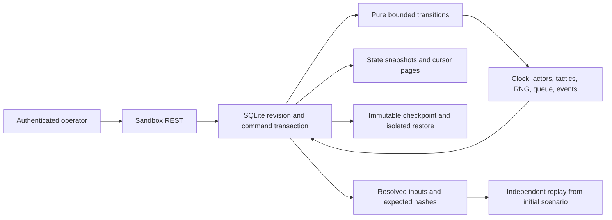

# Authoritative engine integration

The executable backend foundation for #2/#3/#4/#5/#7/#9 and engine-owned
checkpoint/branch hooks for #6/#8 is `backend/app/sandbox`. Versions are
`zone-engine/1`, `sandbox/1`, `sha256-counter/1`. Machine-readable schemas are
in `models.py` and FastAPI `/openapi.json`. Existing replay, frontend, imported
matches, analytics and observer features are preserved. Satvik's preparation
branches and Vishwam's asset review are not modified.

## Architecture and time



The core owns an integer second tick. `step` advances a paused session;
`advance` advances a resumed session. Both perform 1..300 ticks, stopping at full
time. `resume` permits advance; it **does not start a wall-clock worker**. An
operator/runner sends bounded commands. Reads, browser rendering and elapsed real
time never change the tick. Browser interpolation is presentation only.

Lifecycle: paused, running, completed, cancelled. Full time and cancellation
reject further gameplay mutations. Terminal sessions may still be checkpointed.
Reset means a new runtime. Undo means a new branch restored from a checkpoint or
a compensating future tactical command. No dedicated undo/redo endpoint exists.

## Authorization and durable storage

Every sandbox route requires an operator bearer token. Configure either
`PULSE_RUNTIME_TOKEN` for one operator or `PULSE_RUNTIME_TOKENS` as a JSON mapping
of stable operator IDs to distinct tokens of at least 32 ASCII characters.
Generate/provision tokens server-side; never embed them in a frontend bundle or
URL. Missing/invalid server configuration returns 503; wrong credentials return
403. Scenarios, sessions and checkpoints are scoped to the mapped owner;
inaccessible identities return concealed 404s. This is provisioned operator
authentication, not a public signup/judge login UI or collaborative role system.
Token rotation keeps ownership if the mapped operator ID stays the same.

`PULSE_RUNTIME_DB_PATH` defaults to `pulse_runtime.sqlite` beside `PULSE_DB_PATH`.
It MUST be a different file. Runtime schema `user_version=1` has scenarios,
sessions, commands, runtime_events, checkpoints, audit tables. It never changes
the data-hub schema 2 or that database's backup whitelist. Cold migration is
atomic and rechecks the version under the writer lock. Future versions are
rejected. Accepted mutations atomically commit state, appended events, command
receipt, audit and any checkpoint with `BEGIN IMMEDIATE`. SQLite serializes
threads and processes. There is no process-global mutable session registry.

Bounds per DB: 100 scenarios, 100 sessions, 200 checkpoints. Per session: 2048
accepted commands, 4096 audit entries, 1024 interventions, 128 pending actions,
20000 events; ancestry depth 32. Bodies are limited to 2 MB. Sandbox requests
also reject duplicate JSON keys and nonfinite numbers. No automatic expiry or
deletion occurs: cancellation stops gameplay and retains evidence. Operators
archive/rotate full databases offline. Public deployment should apply its gateway
rate limits to authenticated callers.

## Actual routes

All paths start with `/api/sandbox`; all require bearer authentication.

| Method | Path | Contract |
|---|---|---|
| GET | `/versions` | Version/build digest, bounds and driver semantics |
| GET | `/presets` | Map of fully resolved ScenarioConfig objects |
| POST | `/scenarios` | ScenarioConfig -> content-addressed Scenario |
| GET | `/scenarios/{scenario_id}` | Resolved config for JSON save/import |
| POST | `/sessions` | CreateSession -> MutationResult |
| GET | `/sessions/{session_id}/state` | RuntimeView including complete EngineState |
| GET | `/sessions/{session_id}/snapshot` | Engine-owned Snapshot at current committed boundary |
| POST | `/sessions/{session_id}/commands` | Command -> MutationResult |
| GET | `/sessions/{session_id}/events?cursor=0&limit=200` | EventPage, limit 1..1000 |
| GET | `/sessions/{session_id}/match-events?cursor=0&limit=200` | v1 MatchEvent adapter for 5400-second scenarios |
| GET | `/sessions/{session_id}/match` | v1 Match roster metadata for 5400-second scenarios |
| GET | `/sessions/{session_id}/audit` | Accepted/rejected valid command audit |
| GET | `/checkpoints/{checkpoint_id}` | CheckpointView including validated snapshot |
| POST | `/checkpoints/{checkpoint_id}/restore` | RestoreRequest -> new isolated session receipt |
| GET | `/sessions/{session_id}/manifest` | ExperimentManifest |
| POST | `/verify` | ExperimentManifest -> Verification |

Presets: balanced, high-press, late-comeback (aggressive strategy, never a scripted
score), stalemate. GET a preset, edit it, POST the resolved object as a scenario.
The preset label is provenance, not a hidden override of submitted tactics.
Defaults resolve once and the full config is returned/persisted. Fictional teams
only are intended; no external match data is fetched.

## Examples and consistency

Create scenario: POST `/scenarios` with `{"seed":7,"duration_seconds":120}`.
Create session: POST `/sessions` with
`{"operation_id":"create-1","scenario_id":"<returned scenario_id>"}`.
Then send these bodies to `/sessions/{session_id}/commands` in order:

```json
{"operation_id":"step-1","expected_revision":0,"kind":"step","ticks":30}
```
```json
{"operation_id":"press-1","expected_revision":1,"kind":"intervene","requested_tick":30,"team_id":"home","field":"pressing","value":100}
```
```json
{"operation_id":"save-1","expected_revision":2,"kind":"checkpoint"}
```

Every mutation receipt contains session_id, scenario_id, tick, revision,
event_cursor, lifecycle, state_hash, event_hash and nullable checkpoint_id. Fetch
`/state` for the complete state. See [the executed HTTP transcript](examples/sandbox/journey.json)
for actual request/response bodies, IDs and digests, generated through real engine
calls with an isolated temporary database. These examples do not replace tests.

Every accepted command, including pause/resume/checkpoint, increments revision
once. Same operation ID + identical resolved payload returns the ORIGINAL receipt
even after later progress; different payload returns 409 idempotency_conflict.
Competing commands at one revision permit one commit; others receive 409
stale_revision. Repeated rejected payloads remain rejected. Creation IDs are
owner-scoped; command IDs are session-scoped, with inherited IDs reserved on a
restored branch. Use a fresh ID for new intent. Pure core callers must provide
their own durable idempotency layer; apply_command checks revision only.

Event cursors are contiguous, starting with kickoff at 1. Cursor is exclusive.
next_cursor is the last delivered event; event_cursor is the committed frontier,
possibly beyond the page. Read until equal; poll after commands. Empty pages
retain the requested cursor. Ahead-of-frontier cursors return 409 cursor_ahead.
A page reads state metadata and events from one SQLite read snapshot.

Runtime identity is in the envelope. Core event bytes omit runtime IDs so equal
branches hash equally. Evidence references must use (session_id, sequence).
EngineEvent fields: sequence, tick, period, type, team_id, actor_id, recipient_id,
outcome, integer x/y/end_x/end_y, possession_id, policy_revision. Coordinates are
discrete action origins/endpoints. No continuous actor-position frames exist.

Complete EngineState fields: scenario and resolved config; versions; tick,
revision, period, lifecycle; score; possession team/actor/ID; ball coordinates;
22 actor roles, stamina and last-action ticks; tactics/policy revision; all named
RNG keys/counters; pending queue; next queue order; next decision tick; committed
event cursor/history; intervention history. Restore never substitutes a seed for
missing mutable continuation state.

Engine failures use `{"detail":{"code":"stale_revision"}}`. Other codes:
stale_tick, terminal_session, field_already_pending, unknown_team,
incompatible_version (409), corrupt_snapshot (422), not_found (404), unauthorized
(403), transaction_failed/runtime_auth_unconfigured (503), resource limits (429).
Framework input-validation 422 responses retain FastAPI's located error list.
Schema-invalid requests do not enter the engine audit; valid rejected commands
record the rejection without changing revision. Retry identical payload/ID after
ambiguous transport failure, then refresh authoritative state.

## Football policy and interventions

Scenarios allow 60..5400 even duration seconds, two unique teams, exactly 11
unique players each, passing/finishing/defending attributes 0..100, and fixed
neutral/dry conditions. One goalkeeper and role assignments come from formation.
No substitutions, injuries, cards, fouls, offside or calibrated physics are modeled.

| Tactical field | Bounds and actual effect |
|---|---|
| formation | 4-3-3, 4-4-2, 3-5-2; role counts, weighted actor selection, forward progression/shooting |
| pressing | Integer 0..100; defensive pressure attempts and pressing stamina cost |
| compactness | Integer 0..100; challenge success and opposition pass completion |
| directness | Integer 0..100; ball progression distance |
| tempo | Integer 0..100; decision spacing `10 - tempo // 15` seconds and stamina cost |
| risk | Integer 0..100; shot selection, pass failure and dispossession exposure |

The current holder acts, with role-weighted recipients/defenders. Pressure and
challenge precede shot/pass/carry. Player attributes and stamina influence
outcomes. Failed passes and saves transfer possession; goals alone increment
score and schedule the opponent's next-tick restart. Halftime grants the away
team kickoff. Home always attacks increasing x in this fixed-coordinate model.
Thresholds are synthetic parameters, not calibrated real-football probabilities.

Interventions require current revision AND current requested_tick. They become
effective at tick+1 when a step/advance reaches it; acceptance while paused does
not advance time. Duplicate pending changes to one field are rejected. Acceptance
records previous/new values, operation ID, expected revision, requested/effective
ticks and scenario/session identity. State intervention status becomes applied
when executed; immutable acceptance audit preserves the original response. Audit
UTC observation timestamps are separate from deterministic simulation state.
No committed event is modified.

## Determinism, checkpoints and verification

Named RNG streams: actor, decision, duel, finish. Each key is SHA-256 UTF-8 of
`zone-engine/1:{seed}:{stream}`. Each draw is the big-endian SHA-256 integer of
ASCII `{hex_key}:{counter}` modulo the given bound, then increments the counter.
No global random state, real-time decision or unordered iteration is involved.
Stable roster order determines candidates. Tick order: queued tactics in insertion
order, queued restart, period boundary, decision. Redundant restarts at halftime
and fulltime are suppressed. Emission order breaks ties within each decision.

Arithmetic is integer-only. Canonical JSON uses sorted keys, compact separators,
ASCII escapes, explicit null/default fields, meaningful array ordering and no
nonfinite values. SHA-256 covers these ASCII bytes. state_hash includes revision
and full event history; event_hash hashes the event array. Different step batch
sizes yield identical gameplay/events but can differ in revision/state hashes.
Audit timestamps are excluded. The v1 adapter uses UTC epoch 2000-01-01 + tick
and projects away-team x coordinates to the legacy attacking-direction frame.

Actual Python interfaces, from `app.sandbox.engine`:

```python
scenario = build_scenario(ScenarioConfig(seed=7))       # -> Scenario
state = initial_state(scenario)                       # -> EngineState
state = apply_command(state, Command(operation_id="a", expected_revision=0,
                                    kind="step", ticks=300))
snapshot = capture_state(state)                       # -> Snapshot (deep copy)
restored = restore_state(snapshot.model_dump(mode="json"))  # -> EngineState
assert digest(restored) == digest(state)
```

restore_state(Snapshot | dict) validates outer/inner versions, required fields,
full digest, team/actor/score/cursor/queue/RNG/role invariants. No pickle or user
code execution occurs. API restore accepts only owned immutable STORED checkpoint
IDs; client JSON is not an authenticity proof. Capture occurs after the checkpoint
command's revision increment, without ticking. Restore with
`{"operation_id":"fork-1","expected_revision":3}` compares the immutable
checkpoint revision, copies the complete state into a new session at that same
revision, and leaves the parent unchanged. All integer committed boundaries are
legal, including pending actions, halftime and fulltime. Branches retain copied
events/operation history and checkpoint ancestry. Identical future inputs yield
equal core hashes despite different runtime IDs.

`app.sandbox.manifest.verify_manifest(ExperimentManifest) -> Verification`
rebuilds the initial scenario state and replays every command. It compares
per-operation state/event hashes, ancestry checkpoint boundaries, interventions,
every final event digest and final state/event hashes. It reports the first
mismatched component and operation index where applicable, without starting
from a claimed final snapshot. Manifests include resolved config/hash, seed,
engine/schema/RNG versions and derivation, operations, interventions, ancestry,
event/state hashes, execution parameters and implementation_hash. The latter
binds normalized source for models/engine/verifier; incompatible source builds
report a mismatch. Unsupported schemas fail validation. Manifests are unsigned
reproducibility evidence, not externally authenticated historical records.

From backend, no DB/token/network is needed for the independent CLI:

```powershell
python -m app.sandbox.verify_manifest ../docs/examples/sandbox/experiment.json
```

Exit 0 means verified; exit 1 reports divergence or unsupported schema/version.

## Recovery and executable evidence

Use the existing data-hub backup tool only for its own DB. Runtime backup is a
separate trusted offline CLI, from backend:

```powershell
python -m app.sandbox.backup backup data/pulse_runtime.sqlite runtime-backup.sqlite
python -m app.sandbox.backup restore runtime-backup.sqlite recovered.sqlite --sha256 <reported-hash>
```

It uses SQLite's consistent backup API, schema whitelist, integrity/foreign-key
checks, state validation, independent session replay and event parity. It
exclusively creates a new destination, rejects checksum mismatch and never
overwrites live data. Stop the app before activating a recovered file using
PULSE_RUNTIME_DB_PATH; stop old clients and reload state after offline rollback
so confirmations from a later history are discarded. Credentials are external.

```powershell
# backend
python -m pytest tests -q -p no:cacheprovider
# frontend
npm ci
npx playwright install chromium
npm run test:e2e
# repository root: regenerate actual execution examples and timing observations
python scripts/engine-evidence.py
```

Tests execute real transitions, SQLite and authenticated HTTP: full-time
determinism; clock/batching; stable order; exact continuation at ticks
0/1/2699/2700/2701/5399/5400 and a goal boundary; pending-action parity; missing
RNG/queue, corrupt or incompatible snapshots; future-only interventions; ten
paired tactical seeds; parent/branch isolation; concurrent commands/restores;
lost-response retries; interrupted transactions/migrations; owner checks;
separate-process recovery/verifier; tampering; backups; v1 analytics compatibility.

Measured locally on Windows/Python 3.13.15/Intel Core Ultra 9 275HX: seed 7,
5400 ticks in eighteen 300-tick commands generated 1819 events and a 5-2 score;
approximately 109 ms pure-core execution, 12 ms capture, 18 ms restore,
389573 snapshot bytes. These are one-run development observations, not service
latency guarantees. Pinned golden digests are in examples/sandbox/golden.json;
tests compare them on each CI build. Cross-platform parity requires passing
evidence on each actual platform; it is not assumed.

## Remaining integration work

Satvik can integrate authoritative controls, cursor recovery, snapshot/checkpoint
hooks, isolated branches and tactical acknowledgments. The v1 adapter serves
90-minute scenarios; shortened training scenarios use native events because v1
fixes halftime at 2700 seconds. Runtime streams do not silently become imported
match records. No fabricated continuous tracking or runtime WebSocket is exposed;
use state/cursor polling. No automatic real-time scheduler exists.

Higher-level ForkCast trial orchestration, paired-trial seed generation,
comparison DTO/calculation verification, ProofTrail integration and frontend
adapters remain their owners' work. This engine supplies the tested foundation,
not a claim that those product flows are complete. Shared contract review (#2),
external rate limits, deployment, teammate review and CI gates remain required.
