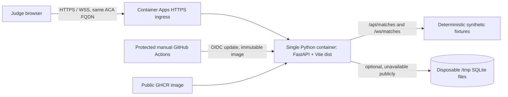

# Azure public demo deployment runbook

Status: **infrastructure and image workflow prepared; no Azure resources have been provisioned and no public URL is live.** Deployment is gated on separate cost approval, subscription access, GitHub environment protection, and a public GHCR image. Last cost lookup: 2026-10-22.

## Chosen topology

One Azure Container App serves the production Vite build and FastAPI API on the same origin. This preserves the current relative `/api/...` routes and `/ws/matches/{match_id}` WebSocket without a second hostname, proxy or CORS expansion.



| Candidate | Assessment for this application |
|---|---|
| A. One Container App | Selected. Existing relative REST and WebSocket clients work on one origin; HTTPS/TLS and WebSockets are provided by ACA HTTP ingress. One resource group deployment creates an environment and app. A public GHCR image avoids an Azure registry. Container local storage is ephemeral, so both SQLite databases are deliberately disposable. ACA Consumption can scale to zero; maximum is one replica per revision. |
| B. Static Web Apps + backend | Not selected. It introduces separate hosting/configuration and requires changing the browser's API and WebSocket origins. Do not rely on an SWA API proxy for WebSockets. Cross-origin API/CORS, backend ingress, and two deployment lifecycles add operational work. |
| C. VM, Kubernetes or another database | Not justified for a synthetic read-only judge demo. A VM adds patching/availability work, Kubernetes adds an unnecessary control plane, and a managed database would cost money and require replacing two distinct SQLite persistence domains. |

ACA HTTP ingress terminates TLS, redirects HTTP to HTTPS by default, supports WebSocket, and currently uses TLS 1.2/1.3. Its HTTP request timeout is 240 seconds; fixture replay streams complete inside that boundary. Confirm current details before deployment in [ACA ingress documentation](https://learn.microsoft.com/en-us/azure/container-apps/ingress-overview). The ingress target is port 8080, and the browser uses the same generated HTTPS FQDN for API and WSS.

## Public judge boundary

The container sets `PULSE_DEPLOYMENT_MODE=public-readonly`. Startup fails closed if runtime/import/admin credentials or Foundry configuration are present, if the runtime driver is enabled, or if the two databases are not separate paths below the operating-system temporary directory.

Public use is limited to the built-in and seed-generated synthetic fixture reads, replay WebSocket, bounded seeded match generation, and deterministic recap. The ASGI boundary allows only those match/read/static paths. It denies other HTTP mutations, the imported-data write/recovery/lifecycle APIs, every authoritative runtime route, agent administration, and the authenticated runtime WebSocket. The ordinary local mode and its credentials remain unchanged. No shared privileged token is in the image or browser.

The public mode has no per-IP rate limiter. Abuse is constrained by the 2,000,000-byte request boundary, schema-bounded seed input, stateless deterministic public POSTs, Uvicorn `--limit-concurrency 32`, 0.5 vCPU/1 GiB per replica, scale-to-zero, and one replica per revision. These controls bound concurrency/resource allocation but do not guarantee a request quota or protect against distributed denial of service. Monitor request and compute costs; disable ingress or remove the app if abuse occurs.

Judges can use `/#/sandbox` for recorded fixture replay, pause/seek, evidence, recap, cues, and observer fallbacks. Authenticated Control Room sessions, interventions, checkpoints, branches, experiments, imports, and hosted Foundry inference are **not** public judge features. Runtime operation remains denied rather than using shared credentials. The application uses its deterministic fallback; no AI provider is configured.

## Data and persistence boundaries

The imported-match SQLite DB (`PULSE_DB_PATH`) and authoritative runtime SQLite DB (`PULSE_RUNTIME_DB_PATH`) remain separate. In this public topology both point to distinct files under `/tmp/pulse-xi`, owned by the unprivileged container user. Container local storage is ephemeral: imported writes and runtime state do not persist and are denied in public mode, and any files would be lost on replica replacement/restart. The three synthetic fixture matches regenerate from the committed seeds. There is no Azure Files mount, shared writable replica, network-mounted SQLite, backup claim, or restart-persistence claim.

The authenticated private runtime requires durable transaction behavior and owner isolation, so it is intentionally not exposed by this deployment. If that product requirement changes, stop and evaluate an appropriate managed database and cost approval before enabling runtime writes; do not attach SQLite to a network share or increase replicas.

## Cost estimate (East US, USD list-rate reference)

Rates were fetched on 2026-10-22 from the official [Azure Retail Prices API](https://prices.azure.com/api/retail/prices?%24filter=serviceName%20eq%20%27Azure%20Container%20Apps%27%20and%20armRegionName%20eq%20%27eastus%27&currencyCode=USD&%24top=1000): Consumption active vCPU **$0.000024/vCPU-second**, memory **$0.000003/GiB-second**, and requests **$0.40/million**. The API also returned idle vCPU $0.000003/second and idle memory $0.000003/GiB-second; with `minReplicas: 0`, an app scaled to zero incurs no replica usage. See official [billing](https://learn.microsoft.com/en-us/azure/container-apps/billing) and [pricing](https://azure.microsoft.com/en-us/pricing/details/container-apps/) for current regional/account terms.

The Dockerfile uses Python 3.13-slim-bookworm and Node 24-alpine multi-architecture manifest digests fetched from the official Docker Hub tag APIs on 2026-10-22; update those digests deliberately with a reviewed base-image change. Estimates assume East US, 0.5 allocated vCPU, 1 GiB memory, one replica, and conservatively charge all allocated vCPU/memory at active rates for every assumed active hour. They are scenario estimates, not invoices or a free-tier promise:

| Month scenario | Assumed active time | Requests | Compute + request estimate before subscription grants |
|---|---:|---:|---:|
| Low use | 10 replica-hours | 20,000 | **$0.55** |
| Expected demo use | 100 replica-hours | 500,000 | **$5.60** |
| Bounded high-use scenario | 730 replica-hours | 5,000,000 | **$41.42** |

The arithmetic uses vCPU-seconds = hours × 3,600 × 0.5 and GiB-seconds = hours × 3,600 × 1. Azure's current per-subscription monthly grants are the first 180,000 vCPU-seconds, 360,000 GiB-seconds, and 2 million external HTTP requests. If the entire grants were unused, the corresponding estimates would be $0, $0, and **$35.22**. They are shared by other subscription Container Apps and are not guaranteed to this app; scale-to-zero does not make the full deployment free. The bounded scenario assumes only one running replica for the full month; temporary platform overlap during a revision update, additional requests, or other resources can exceed it.

Included in these estimates: Container Apps Consumption meters only. Excluded: taxes, currency conversion, outbound data transfer, support plans, custom domain/DNS, any Azure Container Registry (not used), Log Analytics/Azure Monitor ingestion (not enabled), Azure Files/managed database (not used), other subscription usage, GitHub package billing/limits, and any paid AI service. The Bicep template creates no log workspace, registry, storage, database, identity or network. Container stdout/stderr can be streamed on demand with `az containerapp logs show`; request access logs are disabled to avoid recording request paths. Logs are not retained centrally by this template. Set a Cost Management budget/alert in the Azure portal before approving resource creation; a budget is an alert, not a hard spend cap.

The resource group must already exist; neither provision nor teardown deletes it. The one-time Azure creation is an ACA managed environment and one public Container App. Public GHCR image hosting is external to Azure and subject to GitHub's current package terms. Do not proceed until the account-specific Azure Pricing Calculator estimate, region, subscription and maximum spend are explicitly approved.

## Configuration and prerequisites

For a resource owner/operator:

- Azure CLI with Bicep support, an existing dedicated resource group, and permission to create/update Container Apps environments and apps in that group.
- GitHub repository Actions enabled and an environment named `azure-demo` configured with required independent reviewers, allowed deployment branch `main`, and protected variables `AZURE_CLIENT_ID`, `AZURE_TENANT_ID`, `AZURE_SUBSCRIPTION_ID`, `AZURE_RESOURCE_GROUP`, and `AZURE_CONTAINER_APP`.
- An Azure federated identity credential whose subject is `repo:Microsoft-Game-Developer-Hackathon-2026/Pulse-Xi:environment:azure-demo`, audience `api://AzureADTokenExchange`, and issuer `https://token.actions.githubusercontent.com`. Scope its deployment role to the target app and environment: read/write the target Container App and read its managed environment. Do not grant subscription-wide Owner/Contributor. Provisioning separately needs resource-group scope to create the two ACA resources; it is never done by PR CI or the routine deploy job.
- No application secrets are required. The workflow uses OIDC; do not add `PULSE_RUNTIME_TOKEN`, import, administrator, or Foundry credentials.
- The image package must be public in GHCR before Azure can pull it anonymously. Dispatch `publish` first, then set that package to public in GitHub Packages. This is a one-time repository-owner action. The image contains the public repository's application code and no local database, environment file, token or test data.

The standard PR CI builds and smoke-tests locally and compiles Bicep without logging into Azure or creating resources. The Azure deploy workflow only runs by `workflow_dispatch` from `main`; deployment is an `azure-demo` protected-environment job using `azure/login@v2` OIDC. Configure required reviewers in GitHub settings; YAML naming the environment alone does not create a review rule. Workflow shape follows Microsoft's [Container Apps GitHub Actions guide](https://learn.microsoft.com/en-us/azure/container-apps/github-actions) and [GitHub OIDC federation guidance](https://learn.microsoft.com/en-us/azure/developer/github/connect-from-azure-openid-connect).

## Validate, publish, provision and deploy

No command below has been run against Azure for this change. Validate locally without Azure credentials:

```powershell
az bicep build --file infra/azure/main.bicep --stdout > $null
python scripts/container-smoke.py --image pulse-xi:local
```

Publish the image by manually dispatching **Publish or deploy Azure demo** on `main` with `operation=publish`. Retain the source commit and the digest reported by the build action. A commit tag is a lookup aid and can be overwritten; use `repository@sha256:<digest>` for provisioning, deployment and rollback. The provisioning script rejects tags, malformed digests and credential-bearing references before calling Azure CLI. Mark the resulting `pulse-xi-demo` GHCR package public, then review subscription-specific costs and obtain explicit approval. Provision only into a dedicated existing resource group (the script runs `what-if`, then requires both `-ConfirmProvisioning` and an exact typed phrase):

```powershell
./scripts/azure/provision.ps1 -ResourceGroup <dedicated-rg> -Location eastus `
  -Image ghcr.io/microsoft-game-developer-hackathon-2026/pulse-xi-demo@sha256:<64-lowercase-hex-digest>
# Only after cost approval and reviewing what-if:
./scripts/azure/provision.ps1 -ResourceGroup <dedicated-rg> -Location eastus `
  -Image ghcr.io/microsoft-game-developer-hackathon-2026/pulse-xi-demo@sha256:<64-lowercase-hex-digest> `
  -ConfirmProvisioning
```

Set the protected environment variables to that resource group and app name. Dispatch the workflow again with `operation=deploy`. It builds/publishes a source-tagged image and passes the build action's immutable `repository@sha256:digest` output to the existing app; it does not provision infrastructure. GitHub environment reviewers must approve. The job prints the FQDN after updating. The deploy workflow does not create Azure credentials or secrets in the repository.

## Verify and operate

After approval and deploy, run the read-only live smoke against the generated HTTPS origin:

```powershell
python scripts/container-smoke.py --url https://<container-app-fqdn>
./scripts/azure/smoke-deployed.ps1 -Url https://<container-app-fqdn>
```

The HTTP/API/WebSocket part checks HTTPS readiness, root and bundled assets, liveness, fixture API, anonymous import denial, and a real `/ws/matches/comeback-1107` snapshot over WSS. The PowerShell wrapper additionally runs a dedicated Playwright journey (after `npm ci` and Chromium installation) that loads a fixture, seeks, plays/pauses, and generates a synthetic seed against that deployed origin. A successful build alone is not a browser acceptance journey. The smoke must be run against the deployed revision before calling it verified.

Useful commands (run after `az login` as an operator; never paste secrets into shell history):

```powershell
az containerapp show -g <dedicated-rg> -n pulse-xi-demo --query "{fqdn:properties.configuration.ingress.fqdn,revision:properties.latestRevisionName}" -o json
az containerapp logs show -g <dedicated-rg> -n pulse-xi-demo --tail 100
az containerapp revision list -g <dedicated-rg> -n pulse-xi-demo -o table
```

The app uses active revisions in single mode and scale-to-zero. For rollback, retrieve the previously verified `ghcr.io/...@sha256:<digest>` from the release record and, after authorization and target review, run `az containerapp update -g <dedicated-rg> -n pulse-xi-demo --image <prior-digest-reference>`. The current workflow always builds its selected main revision; it has no historical-image rollback input. Do not describe dispatching it as selecting an earlier image. Then rerun the HTTPS smoke. A rollback is a new revision and may incur transient overlap/usage. Do not edit the image tag to a mutable `latest` tag.

Troubleshooting: a failed `/ready` means the bundled `frontend/dist/index.html` or assets are missing; rebuild/redeploy the image. `/health` is liveness only and does not test SQLite or Azure services. Public write routes return 403 by design; the runtime/control-room routes require a separately provisioned private service and credentials. Provider status should remain `not_configured`. Container logs are only available while platform log streaming can reach the active app; this template does not retain them centrally. A failed image pull usually means the GHCR package is still private or the recorded image digest is wrong. HTTPS/WebSocket browser errors should be checked against the ACA FQDN and the smoke command, not fixed by broadening CORS.

## Teardown

Teardown deletes only the named PULSE XI Container App. The resource group remains. To also delete the environment, the script checks the demo tags and that no other Container Apps remain, then asks for a second exact confirmation:

```powershell
./scripts/azure/teardown.ps1 -ResourceGroup <dedicated-rg> -ConfirmTarget
./scripts/azure/teardown.ps1 -ResourceGroup <dedicated-rg> -ConfirmTarget -DeleteEnvironment
```

Review resource IDs and Cost Management after each operation. Delete any separate GitHub package manually if desired. No teardown has been run.

## Verification and deployment state

Local verification on 2026-10-22 used Windows PowerShell, Python 3.14.5 and a temporary Node 24.22.1 install. `cd backend && python -m pytest tests -q -p no:cacheprovider` (run with the repository venv interpreter) passed **324 tests**, with one existing Starlette/httpx deprecation warning. The pinned production Python closure installed in a clean temporary venv, `pip check` passed, `app.main` imported, and no pytest/httpx packages were present. Python, PowerShell and YAML syntax parses passed.

`npm ci` was attempted with Node 24.22.1: the first attempt failed certificate verification (`UNABLE_TO_VERIFY_LEAF_SIGNATURE`); retrying with Node's system CA store then failed DNS resolution (`ENOTFOUND registry.npmjs.org`). TLS verification was not disabled. Consequently `npm run build`, `npm run validate:assets`, and `npm run test:e2e` were attempted but failed because the incomplete install lacked `tsc` and `gltf-validator`; they are not passes. Docker and Azure CLI are not installed on this host, so no Docker image/container or local Bicep compilation was completed. CI adds Docker image smoke and credential-free Bicep compilation for an Ubuntu runner. Cold start and container/API latency are unmeasured because no container engine or Azure deployment is available.

The Container App infrastructure is prepared but not deployed, no staging/public smoke has run, no revision or URL is verified, and no claim of availability is made. Public judge read-only mode intentionally omits authenticated runtime intervention until an isolated public-session design is separately reviewed. No billable Azure resource was created; cost approval remains outstanding.
