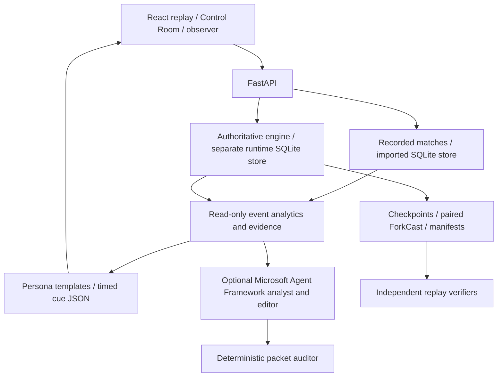

# Pulse-Xi — submission working package

**Tagline:** Synthetic football intelligence, with evidence behind every story.

## Elevator pitch

Pulse-Xi connects synthetic football events to contextual intelligence, inspectable
evidence, personalized recaps and synchronized broadcast cues. Analysts can also
restore a checkpoint and run paired tactical experiments, then independently
replay their results. Its central promise is inspectability: audiences see the
source events and the limits of each explanation.

## Problem, solution and innovation

Fans need understandable moments; analysts need the underlying calculation;
broadcasters need concise timed output. Pulse-Xi presents different depths from
the same source facts. Its deterministic synthetic engine makes tactical
experiments reproducible without pretending to predict professional football.
Evidence validation remains separate from optional model-generated prose.

## Actual architecture

Microsoft Agent Framework / Foundry integration is optional. Default recaps are
verified rule-based templates. Draft #55/#56 add tool orchestration and cost-gated
validation; they are not shipped merely because this document references them.
No authenticated hosted inference was performed for this package.

## Reproducible 110-second capture plan

Use a fresh browser profile, current merged build and the recorded fixture
`comeback-1107`. Derive the first goal cue from
`GET /api/matches/comeback-1107/overlays`; use its actual `start_match_second`
instead of a hand-authored timestamp. This keeps cue selection reproducible.

| Seconds | Real action / narration intent |
|---|---|
| 0–12 | Introduce the problem and synthetic-data boundary on the replay screen |
| 12–32 | Select that cue; show its timed lower third and actual score/activity |
| 32–50 | Open its EVIDENCE control (this PR), inspect calculations and source IDs |
| 50–67 | Close proof; change VIEW from Casual fan to Tactical analyst to Broadcast producer at the same clock. Facts and source identity stay fixed |
| 67–85 | Show cue preview and its JSON export with timing, metrics and event references |
| 85–101 | Show an actually completed paired ForkCast and independent verifier; use the runbook's one-pair/60-second rehearsal, not fabricated trial output |
| 101–110 | State the Microsoft integration actually executed and show public source. Do not call offline templates hosted AI |

Pre-connect locally before capture; keep credentials and private terminal output
out of frame. Record real execution; cuts may remove waiting but cannot fabricate
success. The existing [runtime rehearsal](SUBMISSION_RUNBOOK.md) provisions no
public access and does not itself constitute a submitted video.

## Reproduction and validation

Follow [README](../README.md) for setup. From `frontend`, run `npm run build`
and `npx playwright test broadcast-proof.spec.ts --project=regression` for this
PR's real FastAPI desktop/mobile journey. From `backend`, run `python -m pytest
tests -q`, `python -m app.sandbox.verify_manifest ../docs/examples/sandbox/experiment.json`
and `python -m app.sandbox.verify_experiment ../docs/examples/sandbox/forkcast.json`.
From repository root, `python scripts/release-smoke.py` exercises isolated HTTP
runtime/experiment operations and external verifier processes after the build.

## Submission inventory — prepared versus outstanding

| Deliverable | Actual status / responsible owner |
|---|---|
| Public source | [Pulse-Xi](https://github.com/Microsoft-Game-Developer-Hackathon-2026/Pulse-Xi), public at inspection |
| Description / architecture / evidence map | This package and [judging matrix](HACKATHON_JUDGING_EVIDENCE.md); review against final merged SHA |
| Screenshot capture | Browser tests capture real desktop/mobile proof views locally; approved final screenshots still require selection |
| Video / public video URL | Not recorded or uploaded by this change; authorized representative must publish and verify logged-out playback |
| Working judge access | Not established publicly; verify an allowed test build or approved deployment from a clean environment |
| Rights / security | Vishwam and actual rights holders: #23 remains open; use approved 2D/procedural presentation until cleared |
| Registration / final submission | Team representative must confirm registration, eligibility and actual submission receipt |

## Scope and credits

Synthetic behavior is not calibrated prediction. Positions are sparse event
samples, not continuous player tracking. Pass Difficulty is a heuristic. Hashes
demonstrate reproducibility, not legal authorship or trusted timestamps. Locale
coverage is limited; pending FanDNA #48 does not imply whole-app translation.

Satvik: frontend, replay, consumers, evidence navigation, Data Hub and observer.
Diyan: authoritative engine, persistence, checkpoints and experiment execution.
Mahir: analytics, AI/Foundry, ProofTrail and personalization work. Vishwam:
security, licensing and release decisions. Preserve contributors' existing credits.

## Real fixture screenshots

Captured from this PR's actual FastAPI-backed Chromium journey, not mockups:

- [Desktop cue preview](images/broadcast-evidence/broadcast-cues-1440.png)
- [Desktop source proof](images/broadcast-evidence/broadcast-proof-1440.png)
- [Mobile cue preview](images/broadcast-evidence/broadcast-cues-390.png)
- [Mobile source proof](images/broadcast-evidence/broadcast-proof-390.png)

These show the current main-based visual system. Premium Glass #71 remains a
separate reviewed integration. No continuous tracking or hosted output is shown.
