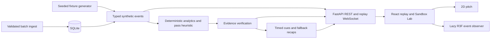

# PULSE XI reference guide

Operational and technical detail moved out of the README so it can stay short. The README has the overview, the live demo and the quick start; this guide has the configuration table, the Match Data Hub, backups, durable workflows, architecture notes, the graphics pipeline, troubleshooting and limitations. Everything here describes the code in this repository.

## Manual development and other platforms

### Manual development (Windows)

```powershell
# Terminal 1, repository root
python -m pip install -r backend/requirements.txt
python -m uvicorn app.main:app --loop app.local_event_loop:create_loop --app-dir backend --host 127.0.0.1 --port 8000
```

```powershell
# Terminal 2, repository root
cd frontend
npm.cmd ci
npm.cmd run dev
```

Open the Vite URL printed by the command. Its API/WebSocket proxy targets port 8000. FastAPI serves `frontend/dist` after production build. Optional backend-only configuration is in [Foundry](FOUNDRY.md); never put secrets in frontend variables. Keep hosted inference disabled without explicit authorization.

### macOS/Linux manual equivalent

From the cloned repository root (Python 3.13 and Node 24 match CI):

```bash
python3 -m venv .venv
source .venv/bin/activate
python -m pip install -r backend/requirements.txt
(cd frontend && npm ci && npm run build)
python -m uvicorn app.main:app --loop app.local_event_loop:create_loop --app-dir backend --host 127.0.0.1 --port 8000
```

These are the same Python/npm entry points; local verification here used Windows, while CI executes on Ubuntu. For frontend development, run `npm run dev` from `frontend` in another terminal; its proxy expects backend port 8000.

## Configuration and trust boundaries

Set variables in the server shell before startup. Do not commit credentials or put them in frontend variables, URLs, logs or browser storage.

| Variable | Actual main behavior |
|---|---|
| `PULSE_RUNTIME_TOKEN` | Single operator bearer capability; at least 32 ASCII characters; unset/invalid configuration fails closed |
| `PULSE_RUNTIME_TOKENS` | Alternative JSON mapping of stable owner IDs to distinct tokens; takes precedence over the single-token configuration |
| `PULSE_RUNTIME_DB_PATH` | Separate durable engine database; defaults beside the match database as `pulse_runtime.sqlite` |
| `PULSE_DB_PATH` | Imported-match SQLite database; default `backend/data/pulse_xi.sqlite` |
| `PULSE_IMPORT_TOKEN` | Shared dataset write capability, at least 32 characters; not private multi-user ownership |
| `PULSE_ENABLE_LOCAL_DATA_ADMIN` | Exact value `1` enables additional direct-loopback administration checks; keep unset publicly |
| `PULSE_STUDIO_PRODUCER_TOKEN` | Optional server-only bearer capability for Director Studio in `local` deployment mode; at least 32 characters; never accepted in `public-readonly` mode |
| `PULSE_FOUNDRY_ADMIN_TOKEN` | Administrative capability for privileged agent operations; see security qualification below |
| `PULSE_ENABLE_FOUNDRY`, `FOUNDRY_PROJECT_ENDPOINT`, `FOUNDRY_MODEL` | Optional provider path; enabled only by exact `true` plus endpoint/model; leave disabled for offline work |
| `PULSE_BUILD_REVISION` | Optional truthful build revision in analysis exports; otherwise unavailable |

Generate a development secret server-side with `python -c "import secrets; print(secrets.token_urlsafe(32))"`. Operator tokens scope private runtime records to provisioned owners; inaccessible identities are concealed with 404. They do not create public signup or a collaborative permission model. Public recorded/imported matches have a different access boundary.

Runtime provisioned credentials remain memory-only in the browser. New saved scenarios and scenario archives reside in runtime SQLite schema 4 (scenario metadata introduced in schema 3), separately from imported-match schema 2 and browser notes. The live Control Room is available at `/#/runtime`; see [LIVE_SANDBOX](LIVE_SANDBOX.md) for saved-scenario, archive, checkpoint, run and ForkCast workflows. Optional hosted agents remain disabled without explicit authorization; no hosted inference or public deployment is certified.

## Analysis workflow

1. Open Sandbox Lab and generate a replay with an integer seed from 0 to 2,147,483,647.
2. Play, pause, change speed and seek forward/backward; statistics follow the replay clock.
3. Filter recorded events and select a pass; inspect the path, difficulty factors and evidence.
4. Open ProofTrail to inspect supporting events; close with Escape.
   The drawer's **One Moment · Three Stories** section frames that moment as Tactical Analyst, Fan Lens (casual) and Broadcast Director from the same verified source events. The director cue is labelled PROPOSED; approval happens in Director Studio. All text is rule-based, with no model call.
5. Open 3D; choose Broadcast, Tactical, Isometric, Event focus or Free camera. Try quality profiles and reset.
6. Inspect source coordinates, return to 2D and continue replay.
7. Bookmark the selected event, save a note, then refresh: match, cutoff, selection and preferences restore in paused mode.
8. Search saved events, navigate back to a source event, or download JSON/CSV from Analysis exports. Filtered event downloads use the same timeline filters.

Replay controls view recorded events, not a running server simulation. Coordinates are normalized units, not measured metres. Markers represent sparse event locations; no continuous tracking, player speeds or ball trajectories are inferred.

## Match Data Hub

Open **MATCH DATA HUB** at **http://127.0.0.1:8000/#/data** to search built-in and SQLite-imported matches by title, identity or team. Cards show event counts and coverage. Expand metadata/data quality for categories, sequence consistency, missing identifiers and coordinate counts. These are factual completeness checks, not a predictive quality score. **Open for analysis** uses existing replay, Pass Difficulty, ProofTrail, bookmarks, persistence, exports and optional 3D event snapshots. Replay controls respect the declared match duration.

### Authorize imports locally

Imports and legacy ingestion **fail closed by default**. Before starting the server, configure a random token:

```powershell
$env:PULSE_IMPORT_TOKEN = python -c "import secrets; print(secrets.token_urlsafe(32))"
.\scripts\start.ps1
```

Enter the same token into the Hub's password field. It is a server-wide write capability, not a user account. It stays in page memory and clears when leaving the Hub or refreshing. Tokens require at least 32 characters. Never place one in frontend environment variables, source files, URLs or localStorage. Remote operation requires HTTPS and explicitly authorized operators; unconfigured public installations cannot import. Host, Origin, CORS and hidden controls never grant permission. Imported matches remain readable by anyone who can access the server; there is no private multi-user data model.

### Import and portable packages

1. Select canonical JSON with `schema_version: "pulse-xi-match-package/1"` (legacy) or `"pulse-xi-match-package/2"` (checksummed), complete `match` metadata and an `events` array. Actual Match/MatchEvent schemas are exposed in `/docs`; see [CONTRACT](CONTRACT.md).
2. **Validate and preview** checks schemas, references, boundaries and conflicts without creating a match or database. Review coverage, warnings and missing fields.
3. **Confirm import** commits one complete dataset transactionally. Identical reimports are no-ops; changed metadata/events conflict instead of partially overwriting existing records. Use a distinct identity for a different dataset.
4. Open the match for real analysis. Missing coordinates and identifiers remain unavailable.

Limits: **2,000,000 bytes per file/request**, **1,000 events per package/stored imported match**, **100 imported matches per installation**, 40 players per team and 32 levels of JSON nesting. Packages preserve event IDs, delivery sequences (including gaps), timestamps, qualifiers and metadata. IDs use 1..160 ASCII letters/digits plus `_ . : -`, starting with a letter/digit. Timezone timestamps, synthetic sources, distinct team/player IDs and six-digit hex team colors are required. Sequence order must agree with match time; tied timestamps are valid. Deletion is an explicitly authorized local operation; no bulk deletion or silent quota cleanup is provided. Archived matches still count toward the 100-match limit.

**Download complete package** includes all recorded events, regardless of replay cutoff. Export/import on a compatible installation preserves source data. Built-in/custom generated IDs are reserved: to import a separate copy, rename `match.match_id` and each event's `match_id` consistently in a newly authored version 1 package, or recompute a version 2 checksum. Never remove checksums merely to bypass a failed recovery validation. Unsupported/oversized output is rejected, never truncated. Supplied source/revision claims persist but are not authenticated; missing provenance stays unavailable. Export timestamps are real; engine hashes, checkpoints and experiment manifests are not invented.

Analysis JSON/CSV exports are **not** complete match packages. CSV import is unsupported because no lossless mapping exists for nested metadata. Package-imported matches cannot be changed through legacy append ingestion, preventing sequence rewrites from invalidating bookmarks. SQLite retains existing tables and transactionally retains `package_metadata` for provenance. Schema version 2 adds lifecycle and deletion records without replacing existing match/event tables.

### Dataset lifecycle and local security

Normal imports retain the existing token requirement. Archive, restore, delete and deleted-identity recovery additionally require **PULSE_ENABLE_LOCAL_DATA_ADMIN=1**, the same valid token, a direct loopback peer, and a localhost/loopback request URL. Forwarded/proxy headers and nonlocal clients are rejected. This explicit mode is only for trusted local administration: keep it unset in public or proxied deployments. No production multi-user destructive authorization model is implemented, and the shared token does not provide ownership isolation.

```powershell
$env:PULSE_IMPORT_TOKEN = python -c "import secrets; print(secrets.token_urlsafe(32))"
$env:PULSE_ENABLE_LOCAL_DATA_ADMIN = '1'
.\scripts\start.ps1
```

Use **Archive status** to inspect active, archived or all datasets. Archiving retains identity, events and provenance. Archived datasets disappear from normal match selection but **existing analysis links remain readable**; Open for analysis also works from archived cards. Restore reverses the archive flag. Built-in/generated fixtures cannot be changed by lifecycle operations.

**Delete imported match** opens a native keyboard-accessible confirmation dialog. Type the exact match ID. The server checks both its current generation and revision under a SQLite writer transaction, then removes events, provenance, lifecycle state and match metadata atomically. Stale confirmations cannot delete a recovered or changed dataset. A small deletion ledger retains match ID, deletion ID and time, blocking delayed imports from resurrecting deleted data. Capacity is 10,000 deleted identities; reaching it requires trusted offline maintenance rather than dropping safety records. Deletion is logical, not forensic disk erasure; existing backups are not removed.

Download a complete package before deletion. To recover, select that file and preview it; a deleted identity requires the separate **Confirm dataset recovery** action, current deletion ID and local administrator authorization. Recovery validates checksum and schema, creates a new dataset generation and restores source metadata/events/provenance in an active state. It does not claim to restore engine execution or RNG state. Conflicting live datasets are never overwritten. An interrupted read may finish from its consistent snapshot; new reads after deletion return 404.

Browser notes are not deleted with server data. **Check saved sources** verifies actual match endpoints (a generated match missing from the library is not presumed deleted). Retained notes can be downloaded as explicitly unverified references or individually removed after confirmation. Missing workspaces are preserved with an unavailable-source notice and reset/reload options. Same-origin tabs receive lifecycle notifications; no personal notes or tokens are broadcast. If BroadcastChannel is unavailable, refresh to recheck server state.

### Backups and recovery

Complete exports now use **pulse-xi-match-package/2**, requiring SHA-256 integrity metadata; existing version 1 imports remain supported. Checksum covers normalized typed schema_version/match/events/provenance, excluding integrity, with events sorted by source sequence. It detects corruption, not authorship: it is not a signature or engine manifest. Version 2 requires a compatible updated installation; older strict version 1 clients reject it safely.

For whole-database protection, use the trusted local CLI, not a web database upload. It uses SQLite's backup API to include committed WAL data consistently, verifies schema, integrity, foreign keys and payload identity, and writes only to **new** destination files. Keep backups outside public assets and protect them with operating-system permissions. No database-download or arbitrary SQLite-import API is exposed.

```powershell
# Repository root; create a private destination directory first.
New-Item -ItemType Directory -Path .local-backups -Force
$backupReport = python scripts/database-admin.py backup --destination .local-backups/library-backup.sqlite | ConvertFrom-Json
$backupReport
# Retain the SHA-256 printed in the JSON report. Stop the app before switching databases.
python scripts/database-admin.py restore --source .local-backups/library-backup.sqlite --destination .local-backups/recovered.sqlite --sha256 $backupReport.sha256
$env:PULSE_DB_PATH = (Resolve-Path .local-backups/recovered.sqlite).Path
.\scripts\start.ps1
```

Use only backups produced from your trusted installation. Review the reported source path and counts. If the running server uses a custom PULSE_DB_PATH, pass that exact absolute path with --source; relative server overrides are rejected when the CLI cannot determine its working directory unambiguously. Restore never overwrites existing files; it requires the recorded physical-file checksum and validates the copied database before reporting success. SQLite backups preserve archive state and deleted identities; restore rotates local administrative generations/deletion nonces to invalidate pre-restore forms; portable package recovery intentionally creates a new active generation. Legacy schema-1 backups migrate when the updated app opens them. Browser-local workspaces/notes and environment tokens are outside SQLite and are not included in database backups.

### Library performance evidence

On the available Windows/i7-1355U development machine (Python 3.13.14, SQLite 3.50.4), an isolated library of 100 imported synthetic matches / 37,700 generated events was queried three times through TestClient. The old path took 5,770 / 9,470 / 26,760 ms (median 9,470 ms); SQL aggregation in one read snapshot took 798 / 339 / 399 ms (median 399 ms, including migration on the first call). Response size changed from 280,684 to 289,963 bytes because lifecycle metadata is included. These are bounded local measurements under varying machine load, not a throughput SLA. Event models are no longer deserialized for library listing; a regression test enforces that boundary. No speculative database replacement, new index or pagination framework was added. A subsequent integration run on the same 100-match/37,700-event workload measured library median 967 ms (three samples), match lookup 40 ms, event retrieval 67 ms and package export 114 ms; single import/archive/restore/delete/recovery operations took 105/39/64/54/552 ms. This run overlapped browser verification and demonstrates load sensitivity rather than a stable 399 ms guarantee. The event query plan uses the existing match/sequence unique index.

## Durable analysis workflows

Workspace and bookmarks are local to this browser profile/origin, not authenticated accounts or engine checkpoints. No event feeds are stored locally. Workspaces use a versioned record (16,000-character read cap), autosave plus page-hide flushing, and source ID/sequence/time validation. Match/event changes, corrupt schemas, unavailable storage and cross-tab conflicts are reported with reset/recovery controls. An analysis link resolves current source events; after consuming it, refresh follows the saved workspace rather than repeatedly resetting to the old URL timestamp.

Bookmarks store match/event references, sequence/time and a note of up to 500 characters. The limit is 200 across all matches (256,000-character read cap). Save/update notes explicitly; unsaved typing is not retained. References are checked against actual events before navigation/export. Search/removal and confirmed reset work locally. Browser Web Locks serialize bookmark updates where available; older browsers fall back to read-before-write/last writer wins. Workspace changes from another tab do not move this tab automatically: reload the saved workspace or explicitly keep this tab. This is not multi-user synchronization.

Analysis exports support JSON and UTF-8 CSV: visible events, timeline-filtered events, selected pass/factors, existing match metrics, and source-validated bookmark references/notes. Backend exports reuse the scorer/metrics services, enforce match/cutoff, allow at most 5,000 source events and 8MB output, and never silently truncate. Narrow the cutoff when a limit is reached. CSV uses a UTF-8 BOM, standard quoting and formula-injection protection; nested values are JSON cells, nulls are empty cells and numeric zero stays zero. Empty CSVs have headers only; use JSON when empty-export metadata is needed.

JSON includes schema, real generation time, cutoff, source IDs, fixture seed and available formula version/units. Build revision is null unless backend `PULSE_BUILD_REVISION` is set; generator version/engine manifest are explicitly unavailable. Local notes are unverified analyst text, never evidence claims. Bookmarks after the cutoff or with missing/changed source events are omitted from export. Clearing browser data/private browsing/origin changes can remove local records; export references when needed. There is no cloud backup or history of multiple workspaces.

## Architecture and stack

The optional **3D Observer** adds an original Blender stadium, recorded event markers, five camera modes and Low/Medium/High graphics profiles. The default 2D view remains independent of WebGL. See the [graphics toolchain, reproducible assets and measured results](PROFESSIONAL_3D_GRAPHICS_UPGRADE.md). Positions remain sparse synthetic event snapshots; no continuous player tracking is inferred.



Frontend: React 19, strict TypeScript, Vite, Tailwind/CSS, Three.js and React Three Fiber. Backend: Python, FastAPI, Pydantic and SQLite. pytest/Playwright exercise APIs and browsers. Calculations stay outside language models. The integrated authoritative backend owns simulation state, clock and RNG; browser replay/inspection state does not advance it.

```text
backend/app/                  models, generator, analytics, evidence, APIs, storage
backend/tests/                API, determinism, persistence and scoring tests
frontend/src/features/passes/  pass inspector and typed responses
frontend/src/features/sandbox/ fixture setup, timeline, replay transport
frontend/src/features/observer/ lazy GLB/procedural 3D, cameras, evidence overlay
frontend/tests/               browser and transport regressions
scripts/                      Windows build/start and scoring benchmark
docs/                         contracts, methodology and evidence
.github/workflows/            backend/frontend/browser CI
```

## Graphics pipeline and provenance

Main includes original editable Blender sources, exported GLBs, manifest hashes, export tools and Khronos validation. The observer supports an asset-enabled scene and procedural fallback; Blender is optional for authoring, not required to run the web application. The renderer probe supports both configurations. Unreal #34 remains optional offline authoring. No mandatory CUDA, RTX, Pixel Streaming or cloud GPU is introduced.

Rights and release status of the artwork are recorded in [LICENSE_AND_RIGHTS_DECISIONS](LICENSE_AND_RIGHTS_DECISIONS.md); see also the [asset licences](../assets/LICENSE.md) and the [manifest](../assets/manifest.json).

Physical Iris Xe and software-renderer evidence are separate; neither certifies RTX performance. The earlier physical procedural-scene probe did not load the GLB kit and does not establish asset-loaded hardware performance. Recorded event positions remain sparse snapshots, not continuous tracking.

### Repeat physical-GPU measurement

With the application running, use the frontend directory:

```powershell
$env:PULSE_GRAPHICS_HARDWARE='1'
$env:PULSE_GRAPHICS_URL='http://127.0.0.1:8000'
npm run measure:graphics
```

The headed browser rejects software/unknown renderer identity and records atomic `running`/`failed`/`passed` reports in ignored `test-results/graphics/run-*/report.json`. Set `PULSE_GRAPHICS_EXPECT_GPU='RTX 5070'` on Diyan's machine, or the actual Iris renderer on Satvik's, to reject the wrong selected GPU. Reports include repeated active-orbit browser frame pacing and bounded interaction/heap observations; they do not certify GPU timer FPS or replace a longer physical test. Without hardware opt-in the probe uses headless Chromium. Keep the browser visible/unoccluded. See [isolated startup, workload and failure semantics](GRAPHICS_BENCHMARK.md).

## Troubleshooting

| Symptom | Action |
|---|---|
| Python import failure | Use the intended interpreter/venv; install `backend/requirements.txt` |
| Missing or stale Node modules | Run `npm ci` in `frontend`; check Node version |
| Port 8000 occupied | Stop its known owner or use another manual uvicorn port; do not terminate unknown processes |
| Startup exits | Fix the first dependency/build error; startup stops on failures |
| Blank/failed 3D | Return to 2D, try Low, check WebGL2/hardware acceleration; replay remains independent |
| Blender not found | Main does not require Blender; asset authors can set `PULSE_BLENDER_PATH` |
| Missing asset validator | Use current main; run `python scripts/asset_contract.py` at the repository root or `npm run validate:assets` after `npm ci` in `frontend`. Historical proposal-only scripts are not current contracts. |

### Limitations

Synthetic streams are simplified and not calibrated against real football outcomes. Full interface localization (the operator routes are English-only), authenticated Microsoft inference and public authenticated runtime intervention remain incomplete. Authoritative paired experiments and independent reproduction are implemented; they describe this synthetic simulation rather than calibrated real-football outcomes. Azure deployment files are prepared, but no public deployment or URL is claimed; see the [cost-gated runbook](AZURE_DEMO_DEPLOYMENT.md). A seed alone is not a full experiment manifest.

Browser regression runs are bounded to two workers to avoid oversubscribing software-rendering contexts on developer laptops; explicit multi-tab and database race tests retain their own concurrency. Deep-link navigation hides stale controls until recorded-source restoration completes. No test retries or suppressed failures are used.

Local startup/test serving uses an explicit Uvicorn loop factory: Windows SelectorEventLoop avoids the observed Proactor socket-shutdown/reset race during request cancellation; Linux keeps Uvicorn auto/uvloop. This is a bounded local server (the Windows selector supports up to 512 sockets), not a high-concurrency public deployment configuration; the backend does not use asyncio subprocess APIs. Errors are not filtered or retried away.

### Authoritative recorded-event analysis

On `main`, `/#/runtime` connects the real server clock, checkpoints and ForkCast to pass analysis, source evidence, local bookmarks, verified JSON/CSV exports and optional 3D. Open **Recorded-event analysis, bookmarks and 3D** after connecting an operator. Short scenarios use the versioned native projection: actual duration, halftime at `duration_seconds // 2`, unchanged event ticks/periods, event counts, pass geometry/evidence and exports. Goal/activity ProofTrail rules retain their event-derived definitions; legacy match-state phase and continuous tracking remain unavailable. Standard 5400-second analysis retains its legacy behavior. Private runtime events are never published to the unauthenticated match library. See [LIVE_SANDBOX](LIVE_SANDBOX.md#native-period-analysis) for contracts and limitations.

Frontend visual materials and layout invariants: [Atelier design system](UI_DESIGN_SYSTEM.md).

## Runtime Control vs Chaos

Authenticated native Control vs Chaos over the recorded formulas is merged (PR #76). The frontend sends `projection=native`; the backend rejects unsupported projections and validates owner, cutoff and source identity. Window choices 300/600/900 keep honest partial-history states. No engine serialization, RNG or formula changed.
