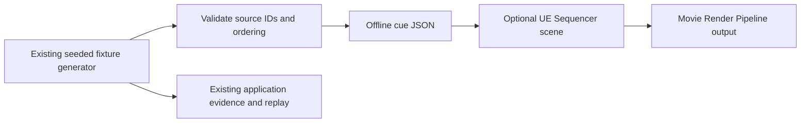

# Unreal Engine cinematic feasibility spike

**Decision (2026-10-22): NO-GO for a UE cinematic in the current hackathon release.**
The machine meets Epic's published recommended memory/graphics-memory numbers,
but has no installed Unreal Editor, Epic Games Launcher, Movie Render Queue,
or media playback tool. No editor installation, scene, render, video, third-party
asset, paid service, or change to the application runtime was made. The current
application's 2D/3D event observer and the locally rehearsed application demo
remain the appropriate product presentation.

## Scope and budget

This was a bounded feasibility pass, not a four-hour production task. It stopped
at environment, source-data and rights gates before installing Unreal or creating
a scene. Only repository inspection, current Epic documentation review, a small
offline event-cue exporter and its tests were undertaken. Unreal/MRQ authoring and
rendering time is therefore **not measured**. No video exists.

## Exact inspected candidate and machine

- Repository main at inspection: `7a8cccf9b9a3b6a6217c5188468493725d01129c`.
  Its successful main CI is [run #437](https://github.com/Microsoft-Game-Developer-Hackathon-2026/Pulse-Xi/actions/runs/39790628382)
  (backend, frontend and browser jobs; 5m16s overall). This is code CI evidence,
  not render evidence.
- Windows 11 Home, build 26200, 64-bit; AMD Ryzen 7 8745HX, 8 cores / 16 logical
  processors; 32 GiB visible system RAM.
- NVIDIA GeForce RTX 5060 Laptop GPU, NVIDIA driver reported by `nvidia-smi` as
  592.01, 8,151 MiB GPU memory. WMI separately reports a Windows driver version
  string `32.0.15.9201`; those driver representations are recorded as returned.
- Epic Launcher, Unreal Editor/commandlet, `UnrealBuildTool`, MRQ, OBS and
  `ffmpeg` were not found on PATH or in the checked standard Epic install paths.
  No Unreal version or plugin state can be claimed. A suitable editor cannot be
  launched on this machine without first installing the toolchain.

Epic's current UE 5.8 hardware page recommends Windows 11, 32 GB RAM, and 8 GB
or more graphics memory; the measured machine meets those headline memory
figures. That does not establish working editor/render compatibility or a render
time. The spike did not download the multi-gigabyte editor or consume the limited
release window proving it.

## Data flow and optional scene design

The offline exporter reads only the repository's built-in deterministic fixture
generator and emits goal shot cues. It does not call the application API, mutate
SQLite, change engine state, add analytics, or fabricate motion. A future scene
would consume this file as presentation-only metadata:



Reproduce the sample from the repository root:

```powershell
python backend/scripts/export_cinematic_cues.py --fixture comeback --output docs/examples/unreal/comeback-cues.json
cd backend
python -m pytest tests/test_cinematic_cues.py -q -p no:cacheprovider
```

The committed [sample cue manifest](examples/unreal/comeback-cues.json) has five
actual goal events from fixture `comeback`, seed `1107`, match `comeback-1107`.
Every cue includes the source event ID/sequence/time, a bounded shot ID, the
synthetic team label and an empty `insight_refs` list because no separate approved
insight reference is produced by this offline exporter. The manifest records
fixture/schema provenance and a project-authored neutral primitive asset
reference whose human rights decision is explicitly pending. The exporter
rejects a wrong fixture identity, absent synthetic provenance, cross-match
events, duplicate IDs, non-monotonic order and unsupported event types. It is
not an Unreal plugin or API.

## Unreal workflow and measurement status

Epic documents Movie Render Pipeline as offline image-sequence/movie rendering;
Movie Render Queue requires enabling its plugin and a Level Sequence. The render
format depends on configured output settings; image sequences are a documented
default, while this spike did not select or verify a video codec/container,
resolution, frame rate, duration, output size, independent playback, or source
clock overlay. A Sequencer/MRQ pipeline is technically plausible, but no sample
render can be claimed.

| Measure | Observed result |
|---|---|
| Unreal/Editor/MRQ version or plugin list | Not installed / not measurable |
| Scene authoring or import time | Not performed |
| Render time, output duration, resolution, frame rate, codec/container | No render |
| Output bytes, peak memory/GPU utilization | No render |
| Media-player decode and source-clock agreement | Not tested |
| Installation/download size or disk impact | Not measured; no toolchain downloaded |
| Paid services/cloud resources | None used |

## Licensing, provenance and release gate

Only the synthetic fixture data and generated cue JSON are used here. No footage,
music, marketplace content, real team mark, player likeness, or existing Blender
GLB is consumed by the exporter. A future scene could use newly authored neutral
primitive geometry, but source-code/artwork ownership and the applicable project
distribution terms still require human confirmation under [issue #23](https://github.com/Microsoft-Game-Developer-Hackathon-2026/Pulse-Xi/issues/23).
The repository asset manifest also records `release_approval` as
`pending-team-review`; a technical CC0 declaration alone is not rights-holder
approval. The cue file's asset reference remains `pending-human-review` and is
not authorization to distribute an Unreal scene or video.

Epic's current [license page](https://www.unrealengine.com/license) distinguishes
license terms by user/revenue and whether an engine-dependent runtime product is
distributed. This spike does not classify the team's legal status or give legal
advice. Any future use must be checked against the then-current Unreal EULA and
the exact use case before distribution. Engine terms would not clear third-party
assets or PULSE XI source/artwork rights.

## Recommendation

**NO-GO for this release and deadline; retain the current application demo.** The
RTX 5060/32 GiB machine is promising enough for a separately approved future
local test, but there is no installed editor, no measured import-to-render path,
no validated media file, and no cleared rights basis for a distributable scene.
Installing and authoring an optional cinematic now is a schedule cost with no
demonstrated judging benefit. Reconsider only after #23's human release gate is
resolved and a time-bounded UE install/render can be run without delaying the
core public video/submission work. No application feature or runtime dependency
is proposed by this spike.

## Official references checked 2026-10-22

- [Movie Render Pipeline / MRQ](https://dev.epicgames.com/documentation/unreal-engine/movie-render-pipeline-in-unreal-engine) — UE 5.8 documentation; plugin and Level Sequence prerequisites; offline render capabilities.
- [Render final images and video](https://dev.epicgames.com/documentation/en-us/unreal-engine/how-to-render-out-final-images-and-video) — UE 5.8 output workflow.
- [Unreal Engine licensing](https://www.unrealengine.com/license) — current license categories and thresholds; check the applicable EULA for the actual release.
- [UE hardware and software specifications](https://dev.epicgames.com/documentation/en-us/unreal-engine/hardware-and-software-specifications-for-unreal-engine) — current recommended hardware reference.
